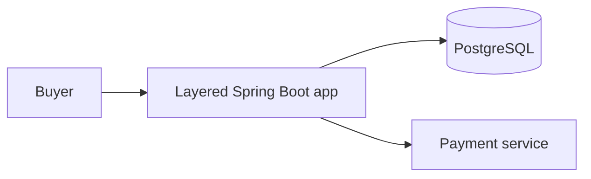
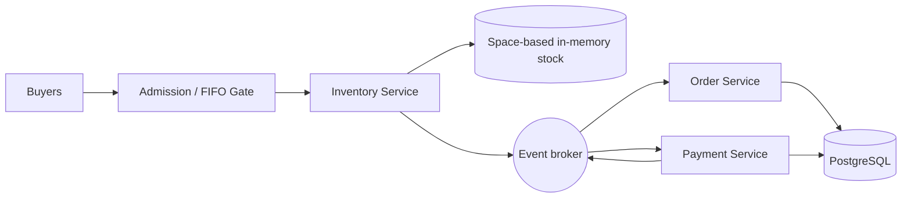
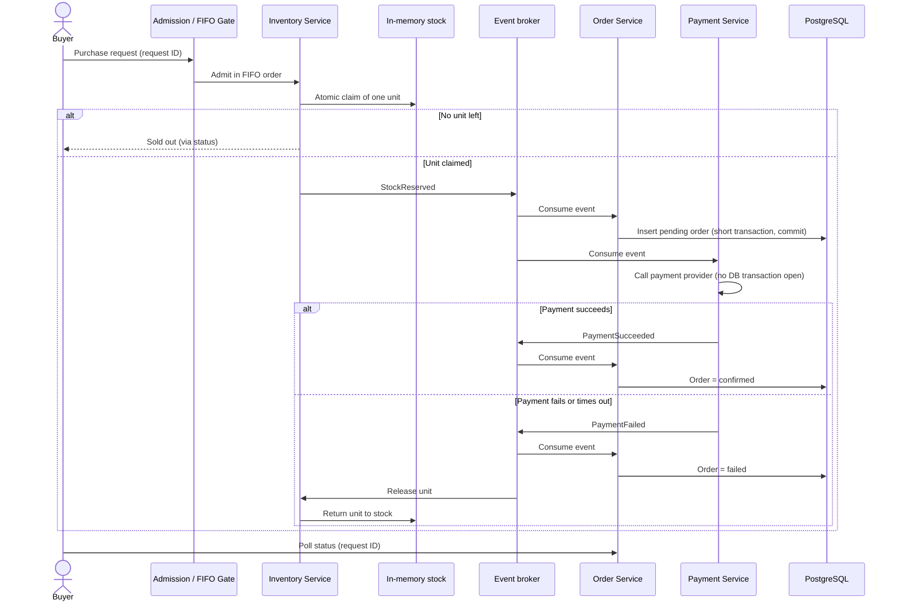
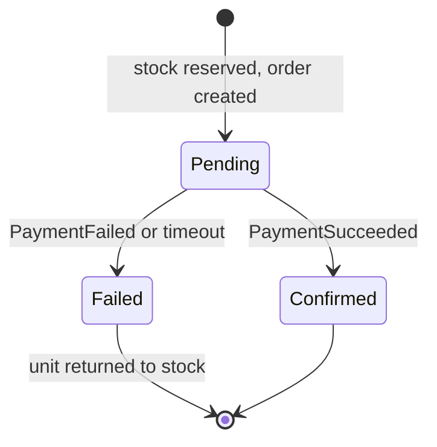

# Architecture Overview — Flash Sale Purchase System

> One-page summary for the presentation. Details: [`srs.md`](srs.md) (v1.3) · [`architecture-patterns.md`](architecture-patterns.md) · [`/adr`](../adr/README.md)

## 1. The problem

100 limited-edition items, about 10,000 buyers, most requests in the first seconds of the sale.

The project asks three questions:

1. Where does the **baseline** break first under load?
2. Which **architecture change** removes that bottleneck?
3. Does the change **measurably** help, without overselling or double-charging?

## 2. Bottlenecks and responses

| ID | Bottleneck | Response | ADR |
|---|---|---|---|
| B1 | Shared inventory contention (one hot DB row) | Space-based in-memory stock | [0007](../adr/keep-hot-stock-in-memory-grid.md) |
| B2 | Overselling | Atomic claim of one unit | [0006](../adr/claim-stock-atomically.md) |
| B3 | DB connections exhausted | Short transactions; stock moved to memory | [0007](../adr/keep-hot-stock-in-memory-grid.md), [0008](../adr/release-database-before-payment.md) |
| B4 | Slow payment blocks the purchase path | Event-driven flow; no DB transaction open during payment | [0008](../adr/release-database-before-payment.md), [0009](../adr/use-event-driven-broker-topology.md) |
| B5 | Retry amplification / duplicate charges | Idempotency keys | [0011](../adr/use-idempotency-keys.md) |
| B6 | Fairness | Server-side admission / FIFO gate | [0005](../adr/control-entry-with-server-side-queue.md) |

Scaling and failure isolation come from separating Inventory, Order and Payment services ([0010](../adr/split-into-microservices.md)).

## 3. Baseline architecture (measured first)

One layered Spring Boot application with PostgreSQL. Every request checks stock, creates an order and calls the payment service in the same synchronous path ([ADR-0003](../adr/use-layered-architecture-as-baseline.md)).

## 4. Target architecture (hybrid)

Microservices + Event-Driven + Space-Based, with a server-side admission/FIFO gate in front. PostgreSQL stays the system of record ([ADR-0004](../adr/combine-patterns-into-final-architecture.md)).

## 5. Purchase flow (target)

## 6. State model

## 7. Pattern roles

| Pattern | Role in this system |
|---|---|
| Microservices | Separate Inventory, Order, Payment so each scales and fails on its own |
| Event-Driven | Payment runs after stock is reserved, so it does not hold the inventory path |
| Space-Based | Hot stock lives in memory, not in one PostgreSQL row |
| Admission / FIFO | Controls how many requests enter the critical path, and in what order |

Rejected: layered monolith as the target (kept as the baseline), and microkernel for sale rules ([ADR-0012](../adr/use-microkernel-for-sale-rules.md)).

## 8. How we will prove it

Workflow: **baseline → load test → find bottleneck → change one decision → test again.**

| Test | Setup | Pass condition |
|---|---|---|
| T-1 Burst | 10,000 buyers, 100 units | Bottleneck found and recorded |
| T-2 Overselling | Many buyers, 1 unit | Oversold units = 0 (PR-1) |
| T-3 Slow payment | Artificial delay | Inventory latency unaffected |
| T-4 Retry | Same request repeated | Duplicate orders/charges = 0 (PR-2) |
| T-5 Payment failure | Some payments fail | Failed units returned to stock (SAF-3) |
| T-6 Fairness | Many buyers arrive together | FIFO order respected |

Measured for every run: latency, throughput, error rate, DB connections, lock wait, payment delay, oversold units, duplicate orders.

## 9. Trade-offs and open items

- **Trade-offs:** eventual consistency, duplicate or out-of-order events, broker or grid failure recovery, distributed stock consistency, harder debugging, higher operational cost. Each must be shown by measurement, not assumed.
- **Open (SRS Appendix C):** queue implementation, in-memory grid technology ([ADR-0013](../adr/choose-in-memory-data-grid-technology.md), proposed: Redis), broker technology ([ADR-0014](../adr/choose-event-broker-technology.md), proposed: RabbitMQ), reservation timeout, latency targets, instance count, deployment topology.
