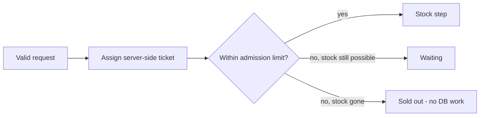

# ADR-0005: Control entry with a server-side admission/FIFO queue

**Date:** 2026-11-10

## Status

Accepted. Concrete implementation is still open (SRS Appendix C, item 1).

## Context

About 10,000 requests arrive at the start of the sale for 100 units. If all of them reach the stock step at once, they queue on the same inventory state (B1); slow responses cause more clicks and retries (B5). Only about 100 buyers can succeed, yet all of them wait.

Fairness is also undefined (B6): without a rule, the winner depends on network speed, retries, or which server handled the request. Client timestamps cannot be the basis for allocation (C-4) because device clocks and network delays differ.

Options considered:

| Option | Assessment |
|---|---|
| More servers / bigger database | Does not remove contention on one stock record |
| Plain rate limiter that rejects excess requests | Protects the system, but rejected buyers retry (B5) and allocation stays random (B6) |
| Order by client click time | Untrusted (C-4) |
| **Server-side admission queue with FIFO ticket order** | Protects the critical path, defines a clear rule, answers excess buyers quickly |

## Decision

All purchase requests pass through an admission gate before the stock step (FR-2, C-8):

1. **Ticket.** Each valid request accepted by the server receives a strictly increasing ticket number at acceptance time, from one atomic counter. Allocation rule: *the first valid request accepted by the server is processed first* (FR-3).
2. **Admission limit.** Only a bounded number of tickets enter the stock step at a time; the limit is configurable and tuned after baseline tests.
3. **Early sold-out.** Once tickets clearly exceed the remaining stock plus a small buffer for failed or expired reservations, later requests receive *sold out* or *waiting* immediately, without database work (FR-4).
4. **Released stock.** When a reservation fails or expires (BR-4), the next waiting ticket is admitted.
5. **No silent failure.** Under overload the gate answers with a status (waiting / retry later) instead of letting the request time out (PR-3).
6. The buyer reads progress through the status endpoint (CI-3, UI-2), so there is no reason to click again (UI-3).

## Consequences

- Far fewer requests reach the stock step, which reduces contention (B1) and retries (B5).
- Allocation is predictable and testable (T-6): confirmed buyers must match ticket order among accepted requests.
- The ticket counter must be atomic and shared by all gate instances; it lives in the in-memory layer (ADR-0007, ADR-0013).
- Strict FIFO still favours buyers who reach the server first; alternative policies were considered in ADR-0012.
