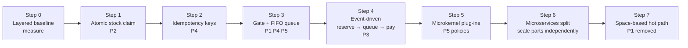

# Flash Sale Bottlenecks — System Design Study

> **When 10,000 people click "Buy" at once.**
> 100 limited-edition shoes · 10,000 buyers · everyone clicks at 12:00.

This repository documents what breaks in a flash-sale system under extreme concurrency, and how we resolve each bottleneck **step by step** by applying five architecture patterns. Every fix is backed by a requirement (SRS) and a recorded decision (ADR), and every decision is validated by load testing — evidence, not guesses.

## Repository map

| Document | What it contains |
|---|---|
| [`docs/srs.md`](docs/srs.md) | Software Requirements Specification following the IEEE 830 template — problems, functional & non-functional requirements, traceability, test plan |
| [`docs/architecture-patterns.md`](docs/architecture-patterns.md) | The five patterns (Layered, Event-Driven, Microkernel, Microservices, Space-Based) applied to the flash sale, with pattern analysis and summary |
| [`adr/`](adr/README.md) | Architecture Decision Records (Michael Nygard template) — one decision per file, in the order we made them |

## The five problems

| ID | Problem | One-line cause |
|---|---|---|
| **P1** | Database jam | Every request locks the same stock row; more app servers just add more waiters |
| **P2** | Overselling | "Check stock" and "take stock" are two separate steps, so two buyers both see "1 left" |
| **P3** | Slow payments | DB connections are held for ~5 s while the bank answers; the pool runs dry |
| **P4** | Retry storms | Slow pages make users click again → 1× → 2× → 4× load |
| **P5** | Fairness | Without a policy, who wins depends on network speed, retries or server luck |

## The resolution, step by step

| Step | Pattern | Fix | Solves | ADR |
|---|---|---|---|---|
| 0 | Layered | Simple build to measure against | — | [use-layered-architecture-as-baseline](adr/use-layered-architecture-as-baseline.md) |
| 1 | Layered | Check-and-take in one atomic step | P2 | [claim-stock-atomically](adr/claim-stock-atomically.md) |
| 2 | Layered | Unique request ID per purchase attempt | P4 | [use-idempotency-keys](adr/use-idempotency-keys.md) |
| 3 | Layered + gate | Server-side FIFO queue / rate limiter | P1, P4, P5 | [control-entry-with-server-side-queue](adr/control-entry-with-server-side-queue.md) |
| 4 | Event-Driven | Reserve → release DB → pay asynchronously; expired reservations return stock | P3, P1 | [release-database-before-payment](adr/release-database-before-payment.md), [use-event-driven-broker-topology](adr/use-event-driven-broker-topology.md) |
| 5 | Microkernel | Allocation policy & payment provider as plug-ins | P5 (flexibility) | [use-microkernel-for-sale-rules](adr/use-microkernel-for-sale-rules.md) |
| 6 | Microservices | Gate, Inventory, Order, Payment as separate services | Independent scaling | [split-into-microservices](adr/split-into-microservices.md) |
| 7 | Space-Based | Hot stock in an in-memory data grid, DB written behind | P1 | [keep-hot-stock-in-memory-grid](adr/keep-hot-stock-in-memory-grid.md) |
| ✓ | Hybrid | Final composition | P1–P5 | [combine-patterns-into-final-architecture](adr/combine-patterns-into-final-architecture.md) |

## Method — how we prove it

1. **Build simple** — the layered baseline (Step 0).
2. **Load-test** — 10,000 virtual users, 100 items, burst at T=0.
3. **Find what breaks first** — DB locks? connection pool? payment delays? The data decides.
4. **Change one thing** — apply the next step, record an ADR, test again.

Each step is committed separately so progress is visible in the commit history.

## Suggested tech stack

Java 21 · Spring Boot · MySQL/PostgreSQL · Redis · RabbitMQ · k6 or Gatling for load tests. See the SRS §2.4 for constraints.
