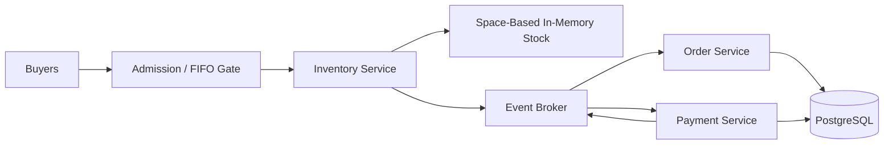

# Flash Sale Bottlenecks — System Design Study

> **When 10,000 people click "Buy" at once.**
> 100 limited-edition items · about 10,000 buyers · most requests at the start of the sale.

This project finds where a flash-sale purchase system breaks under heavy concurrent load and evaluates architectural improvements step by step, measuring each change against a baseline — evidence, not guesses.

## Documents

| Document | Contents |
|---|---|
| [`docs/srs.md`](docs/srs.md) | Software Requirements Specification (IEEE template, v1.3) |
| [`docs/architecture-patterns.md`](docs/architecture-patterns.md) | Evaluation of Layered, Event-Driven, Microkernel, Microservices and Space-Based patterns |
| [`adr/`](adr/README.md) | Architecture Decision Records (14 decisions) |

## Bottlenecks investigated (SRS Appendix B.3)

| ID | Bottleneck |
|---|---|
| B1 | Shared inventory contention |
| B2 | Overselling |
| B3 | Database connection exhaustion |
| B4 | Slow payment dependency |
| B5 | Retry amplification |
| B6 | Fairness |

## Architecture

**Baseline** — one layered Spring Boot application with PostgreSQL ([ADR-0003](adr/use-layered-architecture-as-baseline.md)).

**Target** — hybrid of Microservices, Event-Driven and Space-Based Architecture with a server-side admission/FIFO gate; PostgreSQL remains the system of record ([ADR-0004](adr/combine-patterns-into-final-architecture.md)).

## Step-by-step plan

| Step | Change | Bottlenecks | ADR |
|---|---|---|---|
| 0 | Build and measure the layered baseline | all | [0003](adr/use-layered-architecture-as-baseline.md) |
| 1 | Claim stock atomically | B2 | [0006](adr/claim-stock-atomically.md) |
| 2 | Idempotency keys | B5 | [0011](adr/use-idempotency-keys.md) |
| 3 | Admission / FIFO gate | B1, B5, B6 | [0005](adr/control-entry-with-server-side-queue.md) |
| 4 | Release DB before payment; event-driven flow | B3, B4 | [0008](adr/release-database-before-payment.md), [0009](adr/use-event-driven-broker-topology.md) |
| 5 | Split into Inventory, Order, Payment services | scaling | [0010](adr/split-into-microservices.md) |
| 6 | Hot stock in a space-based in-memory layer | B1, B3 | [0007](adr/keep-hot-stock-in-memory-grid.md) |

After every step: run tests T-1 to T-6 (SRS §6.2) and compare with the baseline.

## Tech stack

Java 21 · Spring Boot · PostgreSQL · in-memory grid (proposed: Redis, [ADR-0013](adr/choose-in-memory-data-grid-technology.md)) · event broker (proposed: RabbitMQ, [ADR-0014](adr/choose-event-broker-technology.md)) · k6 or Gatling.

## Setup and run

_To be added with the baseline implementation (SRS §2.6)._
