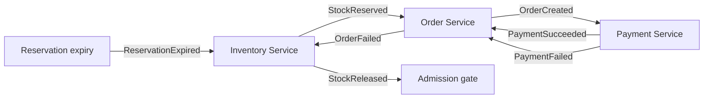

# ADR-0009: Use event-driven broker topology

**Date:** 2026-11-10

## Status

Accepted. Concrete broker technology is decided in [ADR-0014](choose-event-broker-technology.md).

## Context

ADR-0008 requires order creation, payment, confirmation and release to continue asynchronously after the stock claim. Event-Driven Architecture has two topologies:

| Topology | How it works | For this project |
|---|---|---|
| Mediator | A central mediator receives each purchase and orchestrates each step | Every purchase passes through one component: a new central bottleneck and single point of failure; the flow is short and linear, so orchestration is not needed |
| **Broker** | No central controller; each service reacts to an event and publishes the next one through a broker | No single hot component; services scale independently; fits a simple chain with one compensation path |

## Decision

Use the **broker topology** (SI-3, C-7). Main event chain:

Reliability rules:

1. **Transactional outbox** — a state change and its event are written in the same PostgreSQL transaction, then published, so a saved state is never left unannounced (Reliability, §5.4).
2. **At-least-once delivery with idempotent consumers** — each consumer ignores events it has already processed or that no longer match the current state (e.g. release only an active reservation) (FR-14).
3. **Compensation instead of distributed transactions** — a failed payment leads to `OrderFailed` and `StockReleased`, not a cross-service rollback.
4. **Bounded consumers** — payment processing runs with fixed concurrency, giving the payment service a steady flow.
5. **Dead-letter handling** for events that repeatedly fail.

## Consequences

- Slow payment no longer blocks the inventory path (B4).
- Bursts are absorbed by queues instead of overloading downstream services.
- Accepted trade-offs: eventual consistency, event ordering, duplicate messages; end-to-end testing (T-3, T-5) is harder.
- The mediator topology may be reconsidered for more complex workflows outside this scope.
