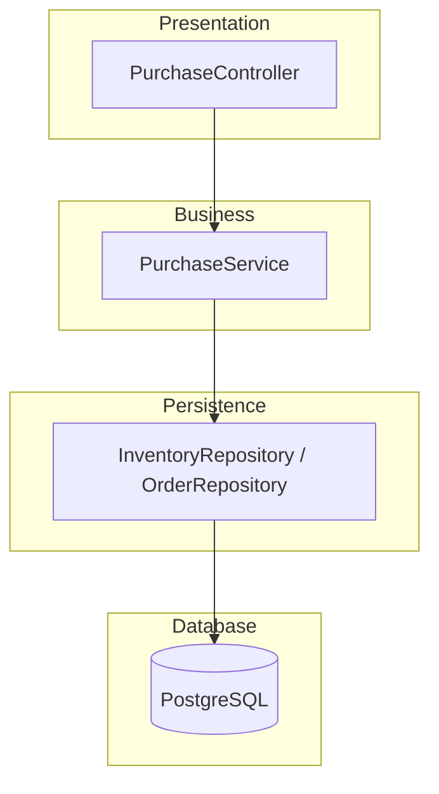
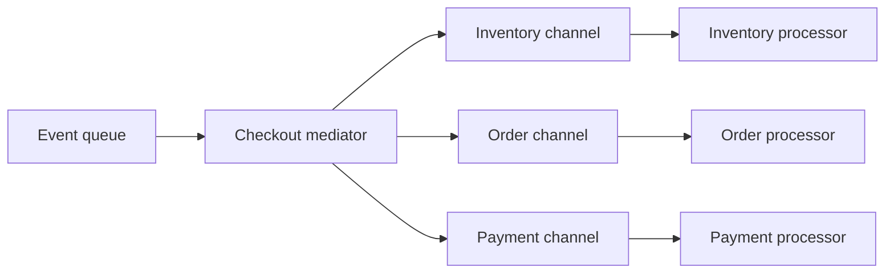
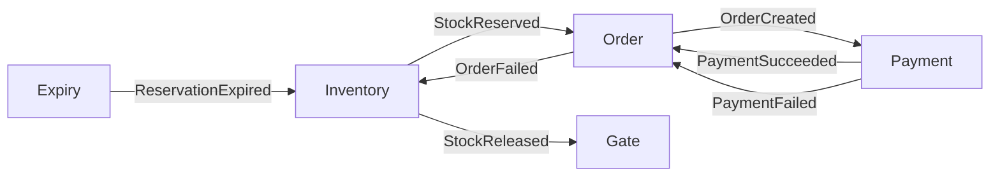
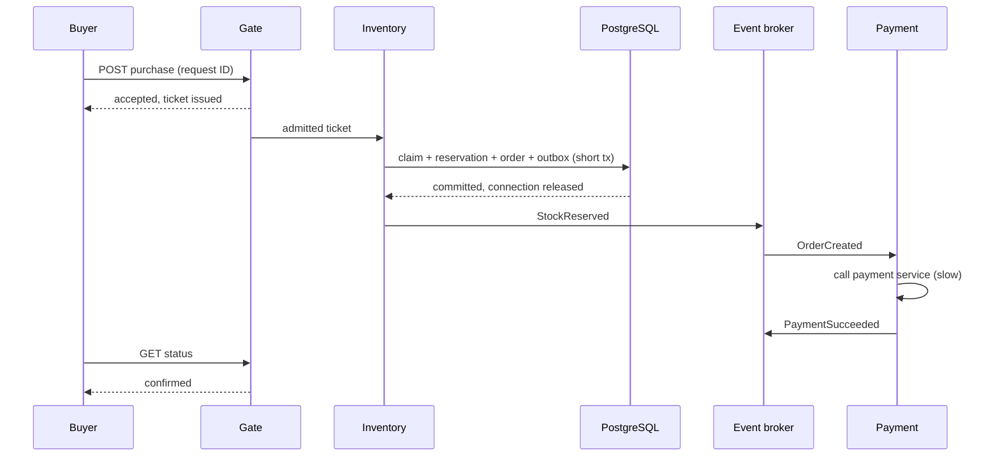
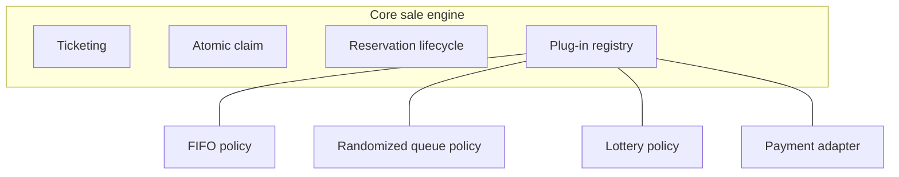
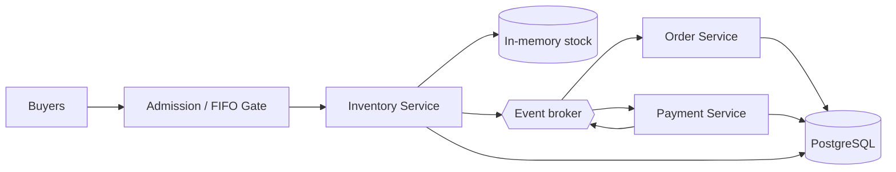
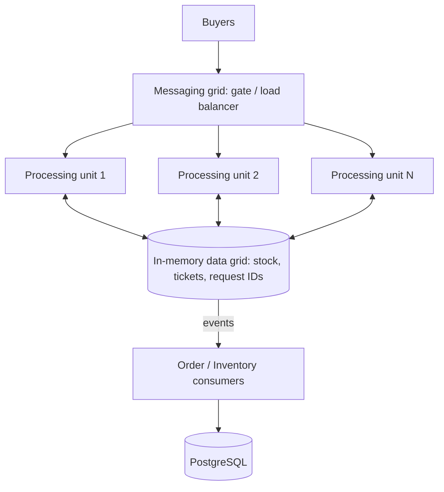
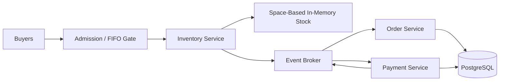

# Architecture Patterns — Flash Sale Purchase System

> Evaluation of five architecture patterns against the flash-sale bottlenecks, step by step, with reasons.
> Requirements: [`srs.md`](srs.md) (v1.3) · Decisions: [`/adr`](../adr/README.md)

## Contents

- [Introduction](#introduction)
- [1. Layered Architecture](#1-layered-architecture)
- [2. Event-Driven Architecture](#2-event-driven-architecture)
- [3. Microkernel Architecture](#3-microkernel-architecture)
- [4. Microservices Architecture Pattern](#4-microservices-architecture-pattern)
- [5. Space-Based Architecture](#5-space-based-architecture)
- [A. Pattern Analysis Summary](#a-pattern-analysis-summary)

---

## Introduction

**Scenario.** 100 limited-edition items, about 10,000 buyers, most requests arriving at the start of the sale. Every purchase passes through five steps:


Easy for one buyer; at 10,000 in the same second, the bottlenecks from SRS Appendix B.3 appear:

| ID | Bottleneck | Cause |
|---|---|---|
| B1 | Shared inventory contention | All requests update the same stock data |
| B2 | Overselling | Check and claim are separate steps |
| B3 | DB connection exhaustion | Connections stay busy while requests wait |
| B4 | Slow payment dependency | External payment delays the whole path |
| B5 | Retry amplification | Slow responses cause repeated requests |
| B6 | Fairness | No defined rule for who gets the stock |

**How patterns are rated.** Each section ends with a *Pattern Analysis* using six characteristics from Richards, *Software Architecture Patterns*: overall agility, ease of deployment, testability, performance, scalability, ease of development.

**Step-by-step method** (SRS §6.2): build the baseline → load-test → identify the bottleneck → change one architectural decision → test again.

| Step | Change | Pattern | Bottlenecks | ADR |
|---|---|---|---|---|
| 0 | Layered monolith baseline, measured | Layered | measure all | 0003 |
| 1 | Atomic stock claim | (any) | B2 | 0006 |
| 2 | Idempotency keys | (any) | B5 | 0011 |
| 3 | Admission / FIFO gate | Admission control | B1, B5, B6 | 0005 |
| 4 | Short transaction, async payment via events | Event-Driven | B3, B4 | 0008, 0009 |
| 5 | Inventory / Order / Payment services | Microservices | independent scaling | 0010 |
| 6 | Hot stock in memory | Space-Based | B1, B3 | 0007 |
| — | Pluggable sale rules (evaluated) | Microkernel | B6 | 0012 (rejected) |

---

## 1. Layered Architecture

### Pattern Description

Components are organised into horizontal layers, each with one role: **presentation**, **business**, **persistence**, **database**. It is the usual default for Spring Boot applications, which makes it the project's **baseline** (ADR-0003).



### Key Concepts

- **Separation of concerns** — the controller does not write SQL; the repository does not decide who wins.
- **Closed layers** — a request passes through every layer in order, giving *layers of isolation*: a change in one layer does not ripple into others.
- **Open layers** — a layer may be marked as bypassable; the baseline keeps all layers closed.
- **Architecture sinkhole anti-pattern** — requests that pass through layers doing nothing but forwarding them; acceptable at roughly 80/20.

### Pattern Example

**Step 0 — baseline.** All five steps in one transaction:

```java
@Transactional
public Order buy(long saleId, long userId) {
    Inventory inv = inventoryRepo.findById(saleId);          // check
    if (inv.getAvailable() <= 0) throw new SoldOutException();
    inv.setAvailable(inv.getAvailable() - 1);                 // claim — separate step (B2)
    Order order = orderRepo.save(new Order(saleId, userId));
    paymentClient.charge(order);                              // slow call, connection held (B3, B4)
    order.confirm();
    return order;
}
```

Running T-1 to T-3 on this version is expected to show lock waits on the stock row (B1), overselling (B2), and pool exhaustion while waiting for payment (B3, B4). The baseline records FR-15–FR-18 metrics so every later step can be compared.

**Step 1 — atomic claim (B2).** *Reason:* check and claim must be one indivisible operation.

```sql
UPDATE inventory SET available = available - 1
WHERE sale_id = :saleId AND available > 0;   -- 1 row → reserved, 0 rows → sold out
```

→ [ADR-0006](../adr/claim-stock-atomically.md)

**Step 2 — idempotency key (B5).** *Reason:* a repeated click must return the first result, not create a second order or charge. → [ADR-0011](../adr/use-idempotency-keys.md)

**Step 3 — admission/FIFO gate (B1, B5, B6).** *Reason:* only about 100 buyers can succeed, so only a bounded number of requests should reach the stock step; the rest get *waiting* or *sold out* quickly. Server-side tickets define the order (C-4). → [ADR-0005](../adr/control-entry-with-server-side-queue.md)

**Still broken:** the payment call is still inside the synchronous request (B3, B4). Closed layers with a request–response flow cannot remove this wait.

### Considerations

- A sound starting point; easy to build, understand and test.
- Tends to become a monolith: one deployable unit, scaled as a whole.
- The slowest dependency (payment) sets the response time of the whole request.

### Pattern Analysis

| Characteristic | Rating | Reason in this project |
|---|---|---|
| Overall agility | Low | Any change redeploys the whole application |
| Ease of deployment | Low | One unit; risky to redeploy before a sale |
| Testability | High | Layers can be mocked; oversell test is easy |
| Performance | Low | Synchronous flow; payment blocks the request |
| Scalability | Low | More instances still meet at one stock row and one DB pool |
| Ease of development | High | Standard Spring Boot structure |

**Verdict:** baseline only, and the internal structure of each service later.

---

## 2. Event-Driven Architecture

Decoupled, single-purpose event processors receive and process events asynchronously. Well suited to bursty workloads. Two topologies:

### Mediator Topology

A central **event mediator** receives the initial event and orchestrates each step by sending events to channels that processors consume.



**For the flash sale:** every purchase would pass through the mediator — a new central bottleneck and single point of failure. The flow is short and linear, so orchestration is not needed. **Not chosen.**

### Broker Topology

No central mediator. Each processor does its step and publishes a new event through a lightweight broker.



**Step 4 — short transaction, then async payment (B3, B4).**

1. **Reserve + create order** in one short transaction, together with an outbox event. *Reason:* the DB connection is held only for milliseconds (FR-10).
2. **Commit and release the connection** before any payment call. *Reason:* new buyers can always start.
3. **Publish** `StockReserved` / `OrderCreated` through the broker. *Reason:* payment proceeds at a steady, bounded rate.
4. **Pay** with the order ID as payment idempotency key.
5. **Confirm or release:** success → `CONFIRMED` (FR-11); failure, timeout or expiry → `FAILED` and the unit returns to stock (FR-8, FR-12, BR-4).



→ [ADR-0008](../adr/release-database-before-payment.md) · [ADR-0009](../adr/use-event-driven-broker-topology.md)

### Considerations

- The buyer does not get the final result in the first response; a status endpoint is needed (CI-3, UI-2).
- No distributed transaction: failures are handled by compensating events.
- The **transactional outbox** keeps state changes and events consistent.
- At-least-once delivery means consumers must be idempotent (FR-14).
- Event schemas must be agreed and versioned.

### Pattern Analysis

| Characteristic | Rating | Reason in this project |
|---|---|---|
| Overall agility | High | Processors change independently |
| Ease of deployment | High | Processors deploy separately |
| Testability | Low | Async and failure orderings are hard to test end-to-end |
| Performance | High | DB held only briefly; work in parallel |
| Scalability | High | Payment consumers scale apart from inventory |
| Ease of development | Low | Outbox, idempotent consumers, compensation, async UI |

**Verdict:** **selected** (broker topology) for everything after the stock claim.

---

## 3. Microkernel Architecture

### Pattern Description

A **core system** with minimal, stable functionality plus independent **plug-in modules** connected through a contract and a registry. For the flash sale the core would be ticketing, claim and reservation lifecycle; plug-ins would be allocation policies, per-user rules and payment adapters.



### Pattern Examples

A pluggable allocation contract:

```java
public interface AllocationPolicy {
    List<Ticket> selectWinners(List<Ticket> entrants, int stock);
}
```

FIFO would sort by ticket number; a lottery policy would shuffle entries collected during a short window, which removes any advantage from network speed.

### Considerations

- A stable contract between core and plug-ins needs careful design.
- The core is still one deployable: the pattern does **not** reduce B1 or B3.
- The SRS requires *a defined* allocation rule (§5.4), not several interchangeable ones, and C-7 fixes the target patterns.

### Pattern Analysis

| Characteristic | Rating | Reason in this project |
|---|---|---|
| Overall agility | High | New policy without touching the core |
| Ease of deployment | High | Plug-ins added independently |
| Testability | High | Each policy is unit-testable |
| Performance | High | In-process calls |
| Scalability | Low | Does not address the hot path |
| Ease of development | Low | Contract and registry design effort |

**Verdict:** **evaluated, not selected** — [ADR-0012](../adr/use-microkernel-for-sale-rules.md). The allocation rule is kept behind one interface so a future policy can be added.

---

## 4. Microservices Architecture Pattern

### Pattern Description

The application is split into **separately deployed service components**, each owning one capability and its data, communicating over the network. In the flash sale the bottlenecks sit in different places (entry, stock, payment), so independent scaling is the main benefit.

### Pattern Topologies

| Topology | Description | Use in this project |
|---|---|---|
| API REST-based | Fine-grained services exposed through REST | Buyer-facing purchase and status endpoints |
| Application REST-based | UI calls coarse-grained services | Not needed |
| Centralized messaging | Services communicate through a broker | Internal flow (reuses Section 2) |



**Step 5 — split along bottleneck lines.**

| Service | Responsibility | Why separate |
|---|---|---|
| Inventory | Claim, reservations, release | Correctness-critical; scaled for the burst |
| Order | Order states, buyer status | Steady load plus status reads |
| Payment | Payment requests and results | Rate limited by the external service (B4) |

The gate is a separately scalable component in front of Inventory. → [ADR-0010](../adr/split-into-microservices.md)

### Avoid Dependencies and Orchestration

The main risk is a *distributed monolith*: Order calls Inventory calls Payment synchronously, so one slow service blocks all of them — B4 across the network. Rules:

1. No synchronous call chains on the purchase path; services react to events.
2. Each service owns its PostgreSQL schema; no shared tables.
3. Choreography, not a central orchestrator (avoids the mediator bottleneck).
4. Needed data travels inside events, accepting small duplication instead of coupling.
5. Failures are handled by compensating events, not distributed transactions.

### Considerations

- Network latency, partial failures and more deployables.
- Eventual consistency: the status may briefly show *processing*.
- Event contracts need tests; logs need a correlation ID.
- Granularity is kept to three services plus the gate.

### Pattern Analysis

| Characteristic | Rating | Reason in this project |
|---|---|---|
| Overall agility | High | Change Payment without touching Inventory |
| Ease of deployment | High | Services deploy and scale alone |
| Testability | High | Small services with clear boundaries |
| Performance | Low | Network hops add latency |
| Scalability | High | Scale the burst-facing parts only |
| Ease of development | High | Small codebases (higher operational effort) |

**Verdict:** **selected** for deployment and scaling boundaries. The Inventory Service still meets one stock value — addressed next.

---

## 5. Space-Based Architecture

### Pattern Description

Designed for extreme, variable concurrency: the central database is removed from the high-concurrency transactional path. Data is held in a replicated **in-memory data grid** inside **processing units**, and the database is updated **asynchronously**.

Parts of the **virtualized middleware**:

- **Messaging grid** — receives requests and routes them to processing units;
- **Data grid** — keeps in-memory data consistent between units;
- **Processing grid** — coordinates requests that need several units;
- **Deployment manager** — starts and stops units as load changes.



### Pattern Dynamics

**Step 6 — hot stock in memory (B1, B3).**

1. **Warm-up.** Before the sale, the initial quantity is loaded from PostgreSQL into the in-memory layer. Processing units are started ahead of the burst. *Reason:* the burst is too fast for reactive scaling.
2. **Route.** Each admitted request goes to any processing unit; none needs a database connection to claim stock.
3. **Atomic claim in memory.** Check limit + check stock + decrement + record buyer as one operation (ADR-0006). Example with the proposed technology (Redis Lua, ADR-0013):

   ```lua
   -- KEYS[1]=stock:{sale}  KEYS[2]=buyers:{sale}  ARGV[1]=userId
   if redis.call('SISMEMBER', KEYS[2], ARGV[1]) == 1 then return -2 end
   local s = tonumber(redis.call('GET', KEYS[1]))
   if s <= 0 then return -1 end
   redis.call('DECR', KEYS[1])
   redis.call('SADD', KEYS[2], ARGV[1])
   return s - 1
   ```

   *Reason:* an in-memory atomic operation avoids row locks and the DB connection pool.
4. **Asynchronous persistence.** Successful claims produce events; reservations and orders are written to PostgreSQL by consumers. PostgreSQL stays the system of record.
5. **Release.** Failed or expired reservations return the unit to memory, exactly once.
6. **Reconciliation.** After each run, in-memory totals, PostgreSQL totals and initial stock are compared (FR-18).

**Data collisions.** With several replicas accepting writes, two units can update the same item in different replicas at once. For a stock counter this is not acceptable, so each stock key has **one primary owner**, with replicas only for failover.

→ [ADR-0007](../adr/keep-hot-stock-in-memory-grid.md) · [ADR-0013](../adr/choose-in-memory-data-grid-technology.md)

### Considerations

- In-memory data can be lost on failure: replication, persistence settings, durable events and reconciliation are needed.
- Only small hot data belongs in memory; relational data stays in PostgreSQL.
- Realistic burst and failover tests are hard to reproduce.
- More moving parts; justified only on the hot path.

### Pattern Analysis

| Characteristic | Rating | Reason in this project |
|---|---|---|
| Overall agility | High | Processing units are small and independent |
| Ease of deployment | High | Units added and removed dynamically |
| Testability | Low | Burst and failover tests are hard |
| Performance | High | No database on the claim path |
| Scalability | High | No single DB row to wait on |
| Ease of development | Low | Grid, replication, async persistence |

**Verdict:** **selected** for the hot inventory state only.

---

## A. Pattern Analysis Summary

### Ratings

| Characteristic | Layered | Event-Driven | Microkernel | Microservices | Space-Based |
|---|---|---|---|---|---|
| Overall agility | Low | High | High | High | High |
| Ease of deployment | Low | High | High | High | High |
| Testability | High | Low | High | High | Low |
| Performance | Low | High | High | Low | High |
| Scalability | Low | High | Low | High | High |
| Ease of development | High | Low | Low | High | Low |

### Bottleneck coverage

| Bottleneck | Layered | Event-Driven | Microkernel | Microservices | Space-Based |
|---|---|---|---|---|---|
| B1 Inventory contention | ✗ | ◐ | ✗ | ◐ | ✔ |
| B2 Overselling | ✔ atomic SQL | ✔ | ✗ | ✔ | ✔ atomic in memory |
| B3 Connection exhaustion | ✗ | ✔ | ✗ | ◐ | ✔ |
| B4 Slow payment | ✗ | ✔ | ✗ | ✔ | ◐ |
| B5 Retry amplification | ◐ with idempotency | ✔ idempotent consumers | ✗ | ◐ | ✔ fast answers |
| B6 Fairness | ◐ with gate | ◐ | ✔ pluggable policies | ◐ | ✔ single-owner ticket counter |

✔ addresses · ◐ helps · ✗ does not address. Admission gate and idempotency are cross-cutting and apply to every option.

### Selected architecture

No single pattern scores well everywhere, so the target combines them (ADR-0004, SRS C-7, C-8):



| Pattern | Status | Where | Bottlenecks |
|---|---|---|---|
| Admission / FIFO gate | Selected | In front of Inventory | B1, B5, B6 |
| Space-Based | Selected | Hot inventory state | B1, B3 |
| Event-Driven (broker) | Selected | After the stock claim | B3, B4 |
| Microservices | Selected | Inventory, Order, Payment | Independent scaling |
| Layered | Baseline only | Step 0; internal structure of services | measurement |
| Microkernel | Not selected | — | B6 (fixed FIFO is enough) |

→ [ADR-0004: Adopt the hybrid target architecture](../adr/combine-patterns-into-final-architecture.md)
