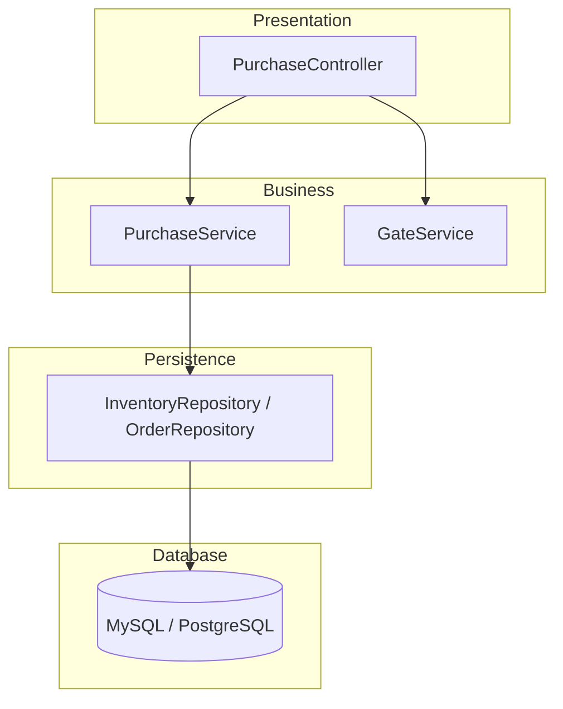
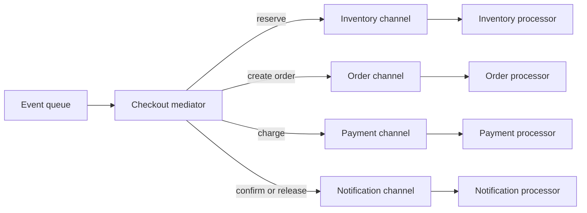
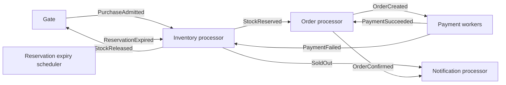
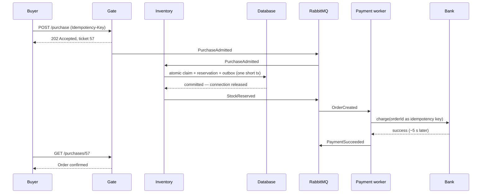
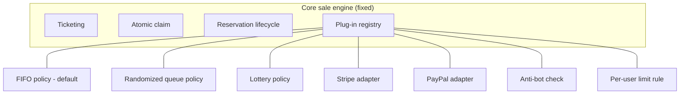
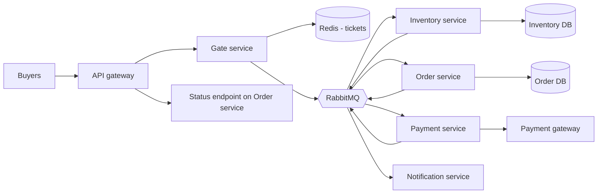
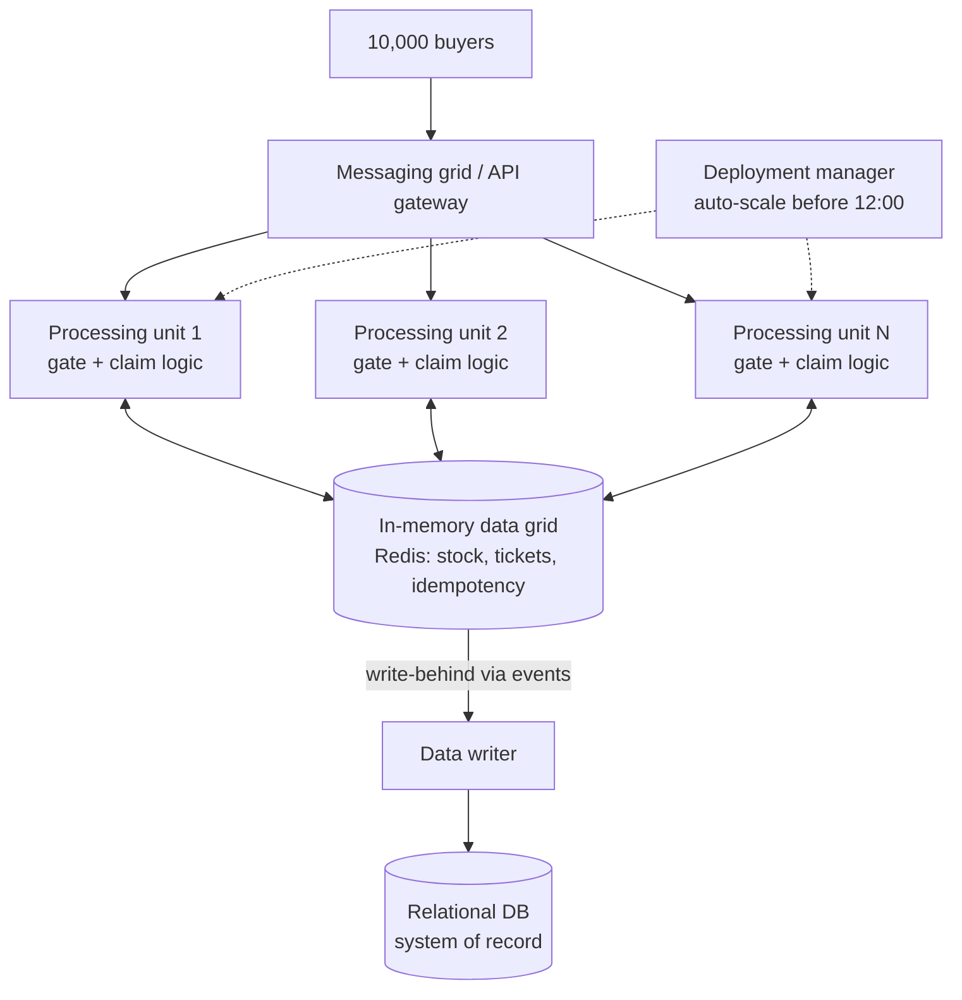
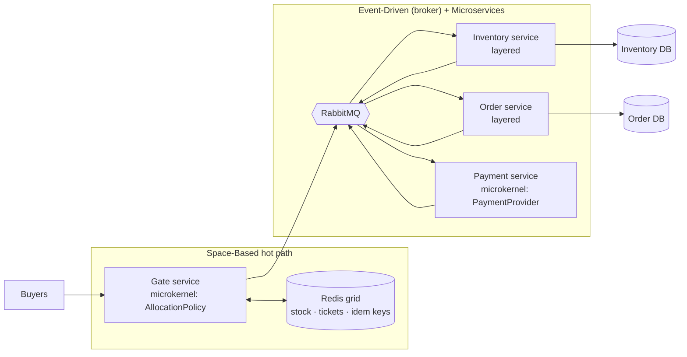

# Architecture Patterns Applied to the Flash Sale

> Five architecture patterns, applied one step at a time to the five flash-sale problems.
> Requirements: [`srs.md`](srs.md) · Decisions: [`/adr`](../adr/README.md)

## Contents

- [Introduction](#introduction)
- [1. Layered Architecture](#1-layered-architecture)
- [2. Event-Driven Architecture](#2-event-driven-architecture)
- [3. Microkernel Architecture](#3-microkernel-architecture)
- [4. Microservices Architecture Pattern](#4-microservices-architecture-pattern)
- [5. Space-Based Architecture](#5-space-based-architecture)
- [A. Pattern Analysis Summary](#a-pattern-analysis-summary)

---

## Introduction

Without a deliberate architecture, a system tends to grow into a "big ball of mud": unclear roles, tight coupling, and no answer to *"how will this behave when 10,000 people click Buy at once?"*. An architecture pattern gives a known shape with known strengths and weaknesses, so we can choose on purpose.

**The scenario.** 100 limited-edition shoes, 10,000 buyers, everyone clicks at 12:00. Every click triggers five steps:


Easy for one buyer. At 10,000 in the same second, five problems appear:

| ID | Problem | Root cause |
|---|---|---|
| **P1** | Database jam | All requests lock the same stock record |
| **P2** | Overselling | Check and take are two separate steps |
| **P3** | Slow payments | DB connections held while the bank thinks (~5 s) |
| **P4** | Retry storms | Slow pages → more clicks → more load |
| **P5** | Fairness | No defined allocation rule |

**How each pattern is evaluated.** Every section ends with a *Pattern Analysis* that rates six characteristics, as in Richards' *Software Architecture Patterns*:

| Characteristic | Question for the flash sale |
|---|---|
| Overall agility | How easily can we change it (e.g. a new allocation policy)? |
| Ease of deployment | Can we redeploy one part right before the sale? |
| Testability | Can we test correctness (no oversell) automatically? |
| Performance | Can it answer 10,000 requests in about one second? |
| Scalability | Does adding servers actually help? |
| Ease of development | How hard is it for our team to build? |

**Step-by-step approach.** We never apply everything at once. Following the project method — *build simple, load-test, find what breaks, change one thing* — each pattern adds one layer of fixes:

| Step | Pattern | Adds | Problems solved |
|---|---|---|---|
| 0–3 | Layered | Baseline, atomic claim, idempotency, gate | P2, P4, P1 (partly), P5 |
| 4 | Event-Driven | Reserve → release DB → pay asynchronously | P3, P1 |
| 5 | Microkernel | Pluggable allocation policies & payment providers | P5 (flexibility) |
| 6 | Microservices | Independent deployment and scaling | Scale per bottleneck |
| 7 | Space-Based | Hot stock in memory; DB written behind | P1 (eliminated) |

---

## 1. Layered Architecture

### Pattern Description

The layered (n-tier) pattern organises components into horizontal layers, each with one role. The standard four are **presentation**, **business**, **persistence** and **database**. It is the de facto default for Java EE / Spring applications and is how most teams naturally start — which makes it our **Step 0 baseline**.



### Key Concepts

- **Separation of concerns.** Each layer only does its own job: the controller does not write SQL, the repository does not decide who wins.
- **Closed layers.** A request must pass through every layer in order (presentation → business → persistence → database). This gives **layers of isolation**: a change in one layer does not ripple into the others.
- **Open layers** (optional). A shared services layer can be marked open so it can be bypassed. We keep all layers closed.
- **Architecture sinkhole anti-pattern.** If most requests pass through layers that do nothing but forward them, the layering is costing latency for no benefit. Rule of thumb: about 80/20 is acceptable.


Load-testing this (SRS T-1, T-2, T-3) is expected to show: oversold units (P2), lock waits on the inventory row (P1), and the connection pool exhausted by the 5-second payment call (P3).

**Step 1 — atomic claim (solves P2).** Reason: the check and the take must be one indivisible operation. The database does it for us with a conditional update:

```sql
UPDATE inventory
SET    available = available - 1
WHERE  sale_id = ? AND available > 0;
-- 1 row updated → reserved; 0 rows → sold out
```

Plus `CHECK (available >= 0)` as a safety net. → [ADR: claim-stock-atomically](../adr/claim-stock-atomically.md)

**Step 2 — idempotency key (solves P4 duplicates).** Reason: a repeated click must be recognised, not processed again. The client sends `Idempotency-Key`; the business layer stores key → result in a table with the key as primary key, and returns the stored result for repeats. → [ADR: use-idempotency-keys](../adr/use-idempotency-keys.md)

**Step 3 — gate in front of the business layer (solves P1 partly, P4, P5).** Reason: even with an atomic update, 10,000 requests still queue on one row. A `GateService` issues server-side tickets with an atomic counter (Redis `INCR`), lets only `stock + 20 %` tickets proceed, and answers everyone else immediately with *Sold out* / waitlist — without touching the DB. → [ADR: control-entry-with-server-side-queue](../adr/control-entry-with-server-side-queue.md)

**What is still broken after Step 3:** the payment call still sits inside the request, holding a DB connection for ~5 s (P3). Layering cannot fix this: the request–response flow through closed layers is inherently synchronous. → move to Event-Driven.

### Considerations

- A solid starting point when unsure — easy to build and reason about.
- Tends to become a **monolith**: one deployable unit, so all parts scale together even if only the stock-claim step is hot.
- Synchronous request flow means the slowest dependency (payment) dictates latency.
- Watch for the sinkhole anti-pattern in simple read requests (e.g. "get sale status").

### Pattern Analysis

| Characteristic | Rating | Flash-sale reasoning |
|---|---|---|
| Overall agility | **Low** | Changing the allocation rule means redeploying the whole monolith |
| Ease of deployment | **Low** | One unit; risky to redeploy just before 12:00 |
| Testability | **High** | Layers can be mocked; the oversell test is easy to write |
| Performance | **Low** | Every request crosses all layers synchronously; payment blocks |
| Scalability | **Low** | More instances all contend for the same stock row and DB pool |
| Ease of development | **High** | Familiar Spring Boot structure |

**Verdict:** correct after Steps 1–3, but cannot meet PR-5/PR-6 (pool usage, connection hold time). Kept as the **internal structure of each service** later on.

---

## 2. Event-Driven Architecture

The event-driven pattern is made of decoupled, single-purpose **event processors** that receive and process events asynchronously. It suits bursty, high-throughput workloads — exactly a flash sale. It has two main topologies.

### Mediator Topology

A central **event mediator** receives an initial event and orchestrates the processing steps by sending processing events to **event channels**, which **event processors** consume.



**Applied to the flash sale:** the mediator would know the full checkout workflow and handle compensation centrally (payment failed → tell inventory to release).

**Why we did not choose it for the purchase path:** every one of the 10,000 purchases would pass through the mediator, making it a new central bottleneck and a single point of failure — the same shape as P1, just moved. Our workflow is also short and linear, so we do not need complex orchestration.

### Broker Topology

There is no central mediator. Events flow in a **chain** through a lightweight **message broker** (RabbitMQ). Each processor does its step and publishes a new event announcing what it did.



**Step 4 — reserve → release DB → pay (solves P3, helps P1).**

1. **Reserve.** Inventory processor runs the atomic claim (Step 1), writes the reservation with `expires_at = now + 5 min`, and writes a `StockReserved` row to the **outbox** — all in one short transaction (≈ milliseconds). *Reason:* the DB connection is held only for this tiny step ("DB busy only here").
2. **Release the DB.** The transaction commits *before* any payment call. *Reason:* the connection returns to the pool immediately, so new buyers can always start (PR-5, PR-6).
3. **Queue.** An outbox relay publishes the event; a **bounded pool of payment workers** consumes it at a steady rate. *Reason:* "process gradually" — the bank sees a controlled flow, not a 10,000-request spike.
4. **Pay.** The worker calls the gateway with the order ID as idempotency key.
5. **Confirm or release.** `PaymentSucceeded` → order `CONFIRMED`. `PaymentFailed` or `ReservationExpired` → inventory adds the unit back (`StockReleased`) → the gate can admit the next ticket from the waitlist. *Reason:* "Payment failed → item back on sale".

The buyer's page polls the status endpoint (UI-2), so no HTTP connection is held while waiting.



→ [ADR: release-database-before-payment](../adr/release-database-before-payment.md) · [ADR: use-event-driven-broker-topology](../adr/use-event-driven-broker-topology.md)

### Considerations

- **Asynchronous complexity.** The buyer does not get the final result in the same HTTP response — needs a status endpoint and a waiting UI.
- **No distributed transaction across processors.** We use compensating events (`StockReleased`) instead of rollback, and the **transactional outbox** so a state change and its event can never diverge.
- **At-least-once delivery.** Every consumer must be idempotent (FR-16), e.g. "release stock" checks that the reservation is still `ACTIVE` before adding the unit back.
- **Contracts.** Event schemas must be versioned and agreed between processors.
- **Error handling.** A processor failure must not lose the event: dead-letter queues plus alerts.

### Pattern Analysis

| Characteristic | Rating | Flash-sale reasoning |
|---|---|---|
| Overall agility | **High** | Processors are independent; adding a notification step touches nothing else |
| Ease of deployment | **High** | Processors deploy separately (more so in broker topology) |
| Testability | **Low** | Async flows and failure paths (payment fails after TTL) are hard to test end-to-end |
| Performance | **High** | DB held for milliseconds; work proceeds in parallel |
| Scalability | **High** | Payment workers scale independently of inventory |
| Ease of development | **Low** | Outbox, idempotent consumers, compensations and async UI add effort |

**Verdict:** the broker topology removes P3 and smooths load (P1). It does **not** by itself make the stock record less hot — that comes in Step 7.

---

## 3. Microkernel Architecture

### Pattern Description

The microkernel (plug-in) pattern has two parts: a **core system** containing the minimal functionality that never changes, and **plug-in modules** that add or vary features. Plug-ins are independent of each other and connect to the core through a **registry** and a well-defined **contract**.

For the flash sale, the core is the purchase engine that must always behave the same (ticketing, atomic claim, reservation lifecycle). What changes from sale to sale — *who gets the shoes* and *how they pay* — becomes plug-ins.



### Pattern Examples

**Step 5 — pluggable allocation policy (supports P5).** Reason: the slides propose strict FIFO now, but list randomized queues and lottery allocation as further study "if fairness requirements change". Hard-coding FIFO would mean rewriting the core each time.

```java
public interface AllocationPolicy {           // the plug-in contract
    String name();                            // "FIFO", "LOTTERY", ...
    List<Ticket> selectWinners(List<Ticket> entrants, int stock);
}

@Component
class FifoPolicy implements AllocationPolicy {
    public String name() { return "FIFO"; }
    public List<Ticket> selectWinners(List<Ticket> t, int stock) {
        return t.stream().sorted(comparing(Ticket::number)).limit(stock).toList();
    }
}

@Component
class LotteryPolicy implements AllocationPolicy {
    public String name() { return "LOTTERY"; }
    public List<Ticket> selectWinners(List<Ticket> t, int stock) {
        List<Ticket> copy = new ArrayList<>(t);
        Collections.shuffle(copy, new SecureRandom());   // seed logged for audit
        return copy.subList(0, Math.min(stock, copy.size()));
    }
}
```

The registry is simply Spring collecting all `AllocationPolicy` beans into a `Map<String, AllocationPolicy>`; the sale configuration (`policy = "LOTTERY"`) picks one. The same contract approach is used for `PaymentProvider` adapters and `EntryCheck` rules (anti-bot, per-user limit).

A lottery policy also changes *when* winners are chosen: entries are collected during a short window (e.g. 60 s), then winners are drawn — which removes any advantage from network speed entirely.

→ [ADR: use-microkernel-for-sale-rules](../adr/use-microkernel-for-sale-rules.md)

### Considerations

- The **contract** between core and plug-ins must be stable; versioning matters once several plug-ins exist.
- Plug-ins must not depend on each other.
- The core is usually a single deployable — the microkernel pattern alone **does not scale** a hot path. It is therefore used *inside* the Gate and Payment components, not as the overall system architecture.
- Policies must be testable in isolation, and the active one is frozen when the sale starts (FR-22).

### Pattern Analysis

| Characteristic | Rating | Flash-sale reasoning |
|---|---|---|
| Overall agility | **High** | New policy = new plug-in; core untouched |
| Ease of deployment | **High** | Plug-ins can be added without redesigning the core |
| Testability | **High** | Each policy is a pure function, unit-testable |
| Performance | **High** | Can be kept lean; no remote calls between core and plug-in |
| Scalability | **Low** | The core is still one unit; does not address P1 |
| Ease of development | **Low** | Designing a good, stable contract takes care |

**Verdict:** ideal for **variability** (fairness policies, payment providers), not for load. Used as an internal pattern.

---

## 4. Microservices Architecture Pattern

### Pattern Description

The application is split into **separately deployed units**, each a **service component** with one business capability, its own data, and communication over the network. It evolved from two directions: monoliths built in layers that became hard to deploy, and service-oriented systems that became too heavy.

For the flash sale, the bottlenecks sit in different places (entry, stock, payment), so being able to **scale and deploy each part independently** is the main benefit.

### Pattern Topologies

| Topology | Description | Flash-sale fit |
|---|---|---|
| **API REST-based** | Fine-grained services exposed through REST APIs, often behind an API gateway | Good for the buyer-facing edge (purchase, status) |
| **Application REST-based** | A traditional UI calls coarse-grained services over REST | Not needed; we have a single purchase UI |
| **Centralized messaging** | Services communicate through a lightweight message broker instead of direct calls | Best for the internal purchase flow — reuses the event-driven design |

**Chosen: API gateway at the edge + centralized messaging (RabbitMQ) inside.**



**Step 6 — split along bottleneck lines (independent scaling).**

| Service | Owns | Scales by | Reason it is separate |
|---|---|---|---|
| Gate | Tickets, rate limits, waitlist | Many instances for the 12:00 burst | Takes the full crowd; must never touch the DB |
| Inventory | Stock, reservations | Few instances (single writer per SKU) | Correctness-critical; small, isolated code |
| Order | Orders, status for polling | Moderate | Most read traffic (status polling) |
| Payment | Payment attempts | Bounded worker pool | Rate is limited by the bank, not by us |
| Notification | Messages to buyers | Any | Failure must not block purchases (AV-2) |

Each service keeps a **layered** internal structure (controller → service → repository).

→ [ADR: split-into-microservices](../adr/split-into-microservices.md)

### Avoid Dependencies and Orchestration

The biggest risk is rebuilding a distributed monolith: Order calls Inventory calls Payment synchronously, so one slow service blocks all of them — P3 again, now across the network.

Rules we apply:

1. **No synchronous call chains** on the purchase path (DC-2). Services react to events instead of calling each other.
2. **Database per service.** Inventory never reads the Order DB. Data needed elsewhere is carried in events (e.g. `StockReserved` includes `price` and `userId`).
3. **Choreography, not orchestration.** No service tells another what to do step by step; each reacts to facts ("stock was reserved"). This also avoids the mediator bottleneck from Section 2.
4. **Accept small duplication** (a price snapshot stored in the order) rather than a shared library or shared table that couples services.
5. **Compensating actions** instead of distributed transactions: payment failed → `PaymentFailed` → Inventory releases the unit.

### Considerations

- **Distributed system costs:** network latency, partial failures, timeouts, and the need for tracing (OB-1 correlation ID).
- **Eventual consistency:** the status page may lag the real state by a moment; the UI must handle "processing".
- **Operational overhead:** more deployables, more monitoring — significant for a student team; we mitigate with Docker Compose and one shared observability stack.
- **Contract testing** between services is required to catch event-schema breaks.
- Service granularity: too fine → chatty and slow; we stop at five services.

### Pattern Analysis

| Characteristic | Rating | Flash-sale reasoning |
|---|---|---|
| Overall agility | **High** | Change the payment service without touching the gate |
| Ease of deployment | **High** | Each service deploys alone; Gate can be scaled up before 12:00 |
| Testability | **High** | Small services with clear boundaries are easy to test individually |
| Performance | **Low** | Network hops add latency compared with in-process calls |
| Scalability | **High** | Gate scales out to absorb the burst; Payment stays bounded |
| Ease of development | **High** | Small codebases per capability (but higher ops effort) |

**Verdict:** gives independent scaling and isolation, but the **Inventory service is still bound to one hot DB row** — the last part of P1.

---

## 5. Space-Based Architecture

### Pattern Description

Space-based architecture targets **extreme and variable concurrency** — the exact flash-sale situation. The insight: the central database is the final bottleneck, so remove it from the transactional path. Application data is held in a **replicated in-memory data grid** inside **processing units**, and the database is updated **asynchronously** afterwards. The name comes from *tuple space* — shared memory between distributed processes.

Two main parts:

- **Processing unit** — application code plus its in-memory data (and optionally replication to peers).
- **Virtualized middleware** — manages the units:
  - **Messaging grid**: receives requests and routes them to a processing unit.
  - **Data grid**: keeps in-memory data consistent across units.
  - **Processing grid**: coordinates requests that need several units.
  - **Deployment manager**: starts and stops units as load changes.



### Pattern Dynamics

**Step 7 — move the hot stock into memory (eliminates P1).**

1. **Before the sale (warm-up).** Stock is loaded from the DB into the data grid (`stock:{saleId} = 100`). The deployment manager scales processing units up ahead of 12:00. *Reason:* the burst arrives too fast to scale reactively.
2. **Request arrives.** The messaging grid routes it to any processing unit — all are equal; none touch the DB.
3. **Atomic claim in memory.** One Lua script runs atomically in Redis (single-threaded per key), so "check + take" cannot interleave (P2 stays solved):

   ```lua
   -- KEYS[1]=stock:{sale}  KEYS[2]=buyers:{sale}  ARGV[1]=userId
   if redis.call('SISMEMBER', KEYS[2], ARGV[1]) == 1 then return -2 end  -- per-user limit
   local s = tonumber(redis.call('GET', KEYS[1]))
   if s <= 0 then return -1 end                                         -- sold out
   redis.call('DECR', KEYS[1])
   redis.call('SADD', KEYS[2], ARGV[1])
   return s - 1                                                         -- remaining
   ```

   *Reason:* an in-memory atomic operation takes microseconds instead of a row lock taking milliseconds, and it is not limited by the DB connection pool.
4. **Write-behind.** The unit publishes `StockReserved`; a **data writer** persists reservations and orders to the DB at a steady rate. *Reason:* the DB becomes a durable record, not the bottleneck.
5. **Release.** `PaymentFailed` / `ReservationExpired` → `INCR stock` (guarded so it happens once per reservation) → the next waitlisted ticket is admitted.
6. **After the sale.** Reconciliation (FR-24) checks grid totals against DB totals.

**Data collisions.** In a classic space-based system with several replicated caches, two units can update the same item in different replicas at once. For a single stock counter this is unacceptable, so the stock key has **one owner** (one Redis primary for that key, with replicas only for failover). Ticket numbers use the same single-owner `INCR`, which also keeps FIFO order consistent (P5).

→ [ADR: keep-hot-stock-in-memory-grid](../adr/keep-hot-stock-in-memory-grid.md)

### Considerations

- **Durability risk:** data in memory can be lost on a crash. Mitigation: Redis AOF persistence (`appendfsync everysec`) plus replicas, outbox-style events, and reconciliation.
- **Not for large relational data** or complex queries — only the small hot data set (stock counter, tickets, idempotency keys).
- **Testing at scale** is hard and expensive: realistic burst tests need dedicated infrastructure.
- **Complexity and cost:** grids, replication and write-behind add moving parts; justified only for the hot path.

### Pattern Analysis

| Characteristic | Rating | Flash-sale reasoning |
|---|---|---|
| Overall agility | **High** | Processing units are small and independently deployable |
| Ease of deployment | **High** | Units are added/removed dynamically |
| Testability | **Low** | Realistic burst and failover tests are hard to reproduce |
| Performance | **High** | In-memory claim; no DB on the request path |
| Scalability | **High** | Processing units scale out; no single DB row to wait on |
| Ease of development | **Low** | Grid, replication, write-behind and reconciliation are complex |

**Verdict:** the only pattern that truly removes P1. Used **only for the hot path** (Gate + stock claim).

---

## A. Pattern Analysis Summary

### Ratings

| Characteristic | Layered | Event-Driven | Microkernel | Microservices | Space-Based |
|---|---|---|---|---|---|
| Overall agility | 👎 Low | 👍 High | 👍 High | 👍 High | 👍 High |
| Ease of deployment | 👎 Low | 👍 High | 👍 High | 👍 High | 👍 High |
| Testability | 👍 High | 👎 Low | 👍 High | 👍 High | 👎 Low |
| Performance | 👎 Low | 👍 High | 👍 High | 👎 Low | 👍 High |
| Scalability | 👎 Low | 👍 High | 👎 Low | 👍 High | 👍 High |
| Ease of development | 👍 High | 👎 Low | 👎 Low | 👍 High | 👎 Low |

### Which problem each pattern solves

| Problem | Layered | Event-Driven | Microkernel | Microservices | Space-Based |
|---|---|---|---|---|---|
| P1 DB jam | ◐ gate reduces load | ◐ steady processing | ✗ | ◐ isolates the hot part | ✔ removes DB from path |
| P2 Overselling | ✔ atomic SQL update | ✔ preserved via outbox | ✗ | ✔ inventory single owner | ✔ atomic Lua script |
| P3 Slow payments | ✗ sync request | ✔ reserve → release → pay | ✗ | ✔ payment isolated | ◐ |
| P4 Retry storms | ✔ idempotency keys | ✔ idempotent consumers | ✗ | ◐ | ✔ keys in memory, fast answers |
| P5 Fairness | ✔ server-side FIFO | ◐ | ✔ pluggable policies | ◐ | ✔ single-owner ticket counter |

✔ solves · ◐ helps · ✗ does not address

### Final composition

No single pattern scores well everywhere, so the final design **combines** them, each where its strength matters:



| Pattern | Where it is used | Why there |
|---|---|---|
| Layered | Inside every service | Simple, testable structure |
| Event-Driven (broker) | Between services | Removes payment wait from the DB; steady processing |
| Microkernel | Gate (allocation policy), Payment (provider) | Varies per sale without core changes |
| Microservices | Deployment & scaling boundaries | Scale the gate for the burst, keep payment bounded |
| Space-Based | Gate + stock claim | Removes the hot-row database bottleneck |

→ [ADR: combine-patterns-into-final-architecture](../adr/combine-patterns-into-final-architecture.md)
