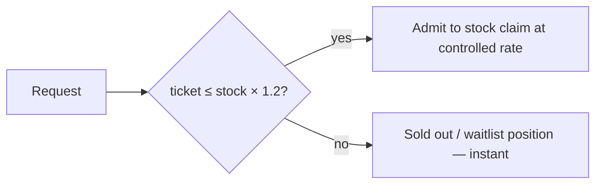

# Control entry with a server-side queue

**Date:** 2026-10-25
**Step:** 3 · **Pattern:** Layered + gate component · **Problems:** P1 DB jam, P4 Retry storms, P5 Fairness · **Requirements:** FR-1 – FR-5, CI-3, UI-2, FA-1

## Status

Accepted

## Context

After Steps 1–2, the system is correct but all 10,000 requests still reach the same inventory row at 12:00. Load tests show lock waits growing and the connection pool saturating — adding app servers sends more people to the same checkout counter. Only 100 buyers can possibly succeed, yet everyone waits.

Fairness is also undefined: whoever's request reaches the database first wins, which depends on network speed, retries, or which server handled it.

Options considered:

| Option | Assessment |
|---|---|
| Bigger DB / more servers | Does not remove contention on one row |
| Plain rate limiter (token bucket) | Protects the DB, but rejected buyers must retry → feeds P4, and allocation stays random |
| Use client click timestamp for ordering | Clocks and networks differ; can be faked (C-4) |
| **Server-side queue: gate issues tickets in acceptance order, admits only as many as can win** | Protects DB, defines fairness, answers losers instantly |

## Decision

A **Gate** sits in front of the purchase logic:

1. **Ticket.** Each accepted request gets `ticket = INCR sale:{id}:ticket` in Redis — a strictly increasing number taken at the moment the server accepts it. Allocation rule: *the first valid request accepted by the server is processed first*.
2. **Admission limit.** Tickets ≤ `stock × 1.2` proceed to the stock claim, at a configurable rate (default 500/s). The 20 % buffer covers payment failures and expired reservations.
3. **Instant answers.** Tickets beyond the limit are told *Sold out* or given a waitlist position immediately, without touching the database.
4. **Waitlist.** When a unit is released, the next waitlisted ticket is admitted.
5. **No timeouts.** Overloaded? Return `429` with `Retry-After`, or `202` with the ticket — never let a request hang (CI-3).
6. **Per-user / per-IP limits** throttle bots (FR-5).
7. The buyer's page polls `GET /purchases/{ticket}` to see its position (UI-2), so no one needs to click again.

## Consequences

- Requests reaching the stock row drop from ~10,000 to ~120 (PR-7); pool usage stays under target (PR-5).
- 98 % of buyers get a fast, final answer, which removes the reason to retry (P4).
- Allocation is predictable, transparent, and independent of client clocks (P5, verified by T-7).
- Redis becomes a critical dependency during the sale; it needs replication and persistence (AS-4).
- Strict FIFO still rewards being fast to the server; alternative policies are enabled later in [Use microkernel for sale rules](use-microkernel-for-sale-rules.md).
- The payment wait (P3) is still inside the request; addressed in Step 4.
