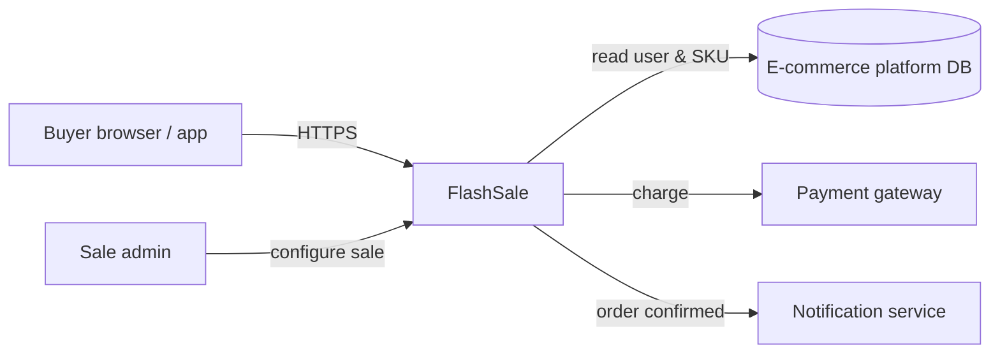
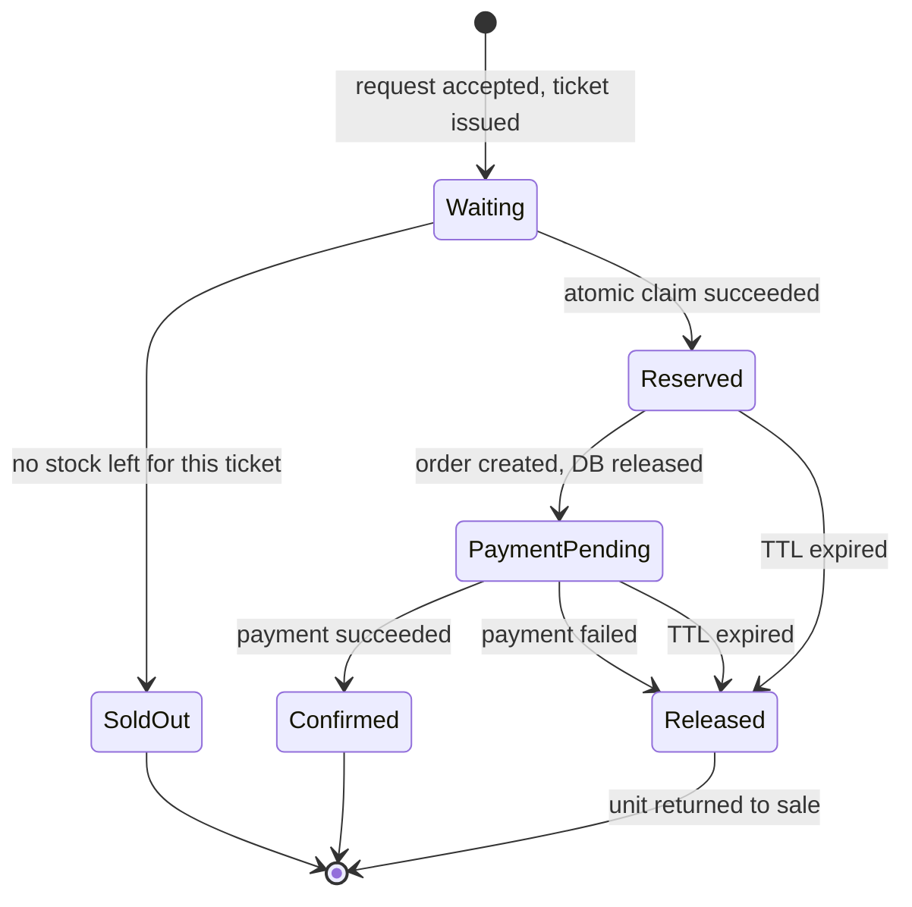
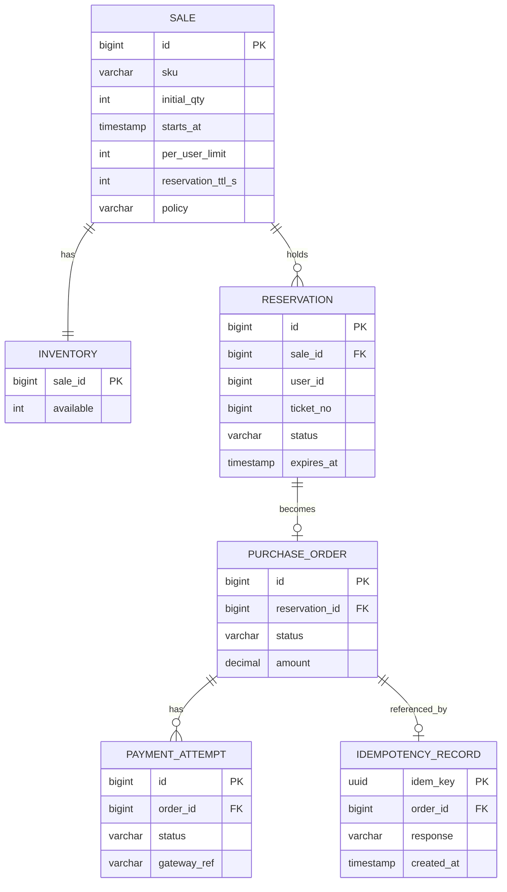

# Software Requirements Specification
## Flash Sale Purchase System

| | |
|---|---|
| **Version** | 1.0 |
| **Date** | 2026-10-26 |
| **Prepared by** | Flash Sale Bottlenecks project team |
| **Template** | IEEE Std 830-1998 (structure retained; aligned with ISO/IEC/IEEE 29148:2018) |
| **Status** | Draft for review |

---

## Table of Contents

1. [Introduction](#1-introduction)
   - 1.1 [Purpose](#11-purpose)
   - 1.2 [Scope](#12-scope)
   - 1.3 [Definitions, Acronyms and Abbreviations](#13-definitions-acronyms-and-abbreviations)
   - 1.4 [References](#14-references)
   - 1.5 [Overview](#15-overview)
2. [Overall Description](#2-overall-description)
   - 2.1 [Product Perspective](#21-product-perspective)
   - 2.2 [Product Functions](#22-product-functions)
   - 2.3 [User Characteristics](#23-user-characteristics)
   - 2.4 [Constraints](#24-constraints)
   - 2.5 [Assumptions and Dependencies](#25-assumptions-and-dependencies)
   - 2.6 [Apportioning of Requirements](#26-apportioning-of-requirements)
3. [Specific Requirements](#3-specific-requirements)
   - 3.1 [External Interface Requirements](#31-external-interface-requirements)
   - 3.2 [Functional Requirements](#32-functional-requirements)
   - 3.3 [Performance Requirements](#33-performance-requirements)
   - 3.4 [Logical Database Requirements](#34-logical-database-requirements)
   - 3.5 [Design Constraints](#35-design-constraints)
   - 3.6 [Software System Attributes](#36-software-system-attributes)
4. [Verification](#4-verification)
- [Appendix A — Problem Analysis](#appendix-a--problem-analysis)
- [Appendix B — Traceability Matrix](#appendix-b--traceability-matrix)
- [Appendix C — Revision History](#appendix-c--revision-history)

---

## 1. Introduction

### 1.1 Purpose

This SRS specifies the requirements for a purchase system that must stay **correct, responsive and fair** during a flash sale: a very small stock (100 units) offered to a very large crowd (10,000+ buyers) at one precise moment (12:00).

It is written for the project team, the supervisor who reviews progress on GitHub, and anyone evaluating the decisions recorded in [`/adr`](../adr/README.md).

### 1.2 Scope

The product, referred to as **FlashSale**, handles the purchase path of a limited-stock sale:

- admitting buyers in a controlled, fair order;
- claiming stock without ever overselling;
- creating orders and taking payment without blocking the database;
- recognising repeated clicks so no buyer is charged twice;
- returning stock to sale when a payment fails or a reservation expires.

**Out of scope:** catalogue management, user registration, shipping, refunds after delivery, marketing pages. These exist in the surrounding e-commerce platform.

**Goal:** sell exactly the available stock, to buyers chosen by a defined and transparent policy, while every buyer quickly receives a clear answer (*won / waiting / sold out*).

### 1.3 Definitions, Acronyms and Abbreviations

| Term | Definition |
|---|---|
| **Flash sale** | A time-boxed sale of very limited stock that starts at a fixed instant |
| **Hot row / hot key** | A single stock record that all concurrent requests try to update |
| **Atomic claim** | A "check stock and decrement" operation that executes as one indivisible step |
| **Reservation** | A temporary hold on one unit, valid until payment completes or a TTL expires |
| **TTL** | Time-to-live: how long a reservation is held before stock returns to sale |
| **Gate / waiting room** | Component that admits buyers at a controlled rate and assigns queue positions |
| **Ticket** | Server-assigned, strictly increasing sequence number given to each accepted request |
| **Idempotency key** | Unique ID per purchase attempt; repeating a request with the same key returns the original result |
| **Retry storm** | Feedback loop where slow responses cause retries, which add more load |
| **Connection pool** | Fixed set of DB connections an application server can use concurrently |
| **Transactional outbox** | DB table written in the same transaction as business data, from which events are published reliably |
| **ADR** | Architecture Decision Record |
| **EDA** | Event-Driven Architecture |
| **FIFO** | First In, First Out |
| **p95 / p99** | 95th / 99th percentile latency |
| **SKU** | Stock Keeping Unit — the product being sold |
| **VU** | Virtual user in a load test |

### 1.4 References

1. IEEE Std 830-1998, *IEEE Recommended Practice for Software Requirements Specifications*.
2. ISO/IEC/IEEE 29148:2018, *Systems and software engineering — Requirements engineering*.
3. M. Richards, *Software Architecture Patterns*, O'Reilly Media.
4. M. Nygard, *Documenting Architecture Decisions*, 2011.
5. ADR repository — <https://github.com/architecture-decision-record/architecture-decision-record>.
6. Project slides: *Flash Sale Bottlenecks — When 10,000 People Click "Buy" at Once*.

### 1.5 Overview

Section 2 describes context, functions, users and constraints. Section 3 lists testable requirements, each with an ID, priority, rationale and the problem it traces to. Section 4 defines verification by load testing. Appendix A analyses the five bottlenecks; Appendix B traces every problem to requirements, ADRs and patterns.

---

## 2. Overall Description

### 2.1 Product Perspective

FlashSale is a subsystem of an existing e-commerce platform. It replaces the normal checkout path only for SKUs marked as flash-sale items.

On a normal day the platform works fine. The problem only appears when everyone competes for the same tiny stock at once — so FlashSale is designed around that single moment.

### 2.2 Product Functions

| # | Function | Summary |
|---|---|---|
| PF-1 | Configure sale | Admin sets SKU, stock, start time, per-user limit, TTL, allocation policy |
| PF-2 | Controlled entry | Admit buyers at a safe rate; give each a server-side queue position |
| PF-3 | Reserve stock | Atomically claim one unit for an admitted buyer |
| PF-4 | Create order | Record a pending order linked to the reservation |
| PF-5 | Take payment | Charge the buyer asynchronously, outside any DB transaction |
| PF-6 | Confirm / release | Confirm on success; return the unit to sale on failure or TTL expiry |
| PF-7 | Deduplicate | Recognise repeated requests and return the original outcome |
| PF-8 | Inform buyer | Show status: waiting (with position), reserved, paid, sold out |
| PF-9 | Monitor | Expose metrics on stock, queue length, pool usage and latency |

Purchase lifecycle implemented by these functions:

### 2.3 User Characteristics

| User class | Characteristics | Implication |
|---|---|---|
| **Buyer** | Large crowd, varied devices and network speeds, impatient, clicks again if the page is slow | Must tolerate retries, give fast feedback, not reward network speed |
| **Bot / scripted client** | Sends requests faster than humans | Gate must rate-limit per user/IP and enforce per-user limits |
| **Sale administrator** | Technical staff configuring a sale | Simple configuration; frozen once sale starts |
| **Operator** | Watches the sale live | Needs real-time dashboards and alerts |

### 2.4 Constraints

| ID | Constraint |
|---|---|
| C-1 | Implementation language: Java 21 with Spring Boot |
| C-2 | A relational DB (MySQL or PostgreSQL) remains the system of record for orders and stock |
| C-3 | Payment gateway latency is outside our control: ~5 s typical, up to 30 s worst case |
| C-4 | Client-side click time cannot be trusted for ordering (clocks and network delays differ) |
| C-5 | Each architecture change is validated by load test before the next one (change one thing at a time) |
| C-6 | Open-source components only (Redis, RabbitMQ, k6/Gatling) |

### 2.5 Assumptions and Dependencies

| ID | Assumption / dependency |
|---|---|
| AS-1 | Buyers are authenticated before the sale opens; each has a stable user ID |
| AS-2 | The payment gateway supports an idempotency key per charge |
| AS-3 | One sale = one SKU; multi-SKU sales run as independent sales |
| AS-4 | Redis and RabbitMQ are deployed with replication and persistence enabled |
| AS-5 | Numerical targets in §3.3 are initial; they are confirmed or revised after the Step 0 baseline test |

### 2.6 Apportioning of Requirements

| Release | Content |
|---|---|
| **R1 (core)** | Atomic claim, idempotency, gate with FIFO queue, async payment, TTL release |
| **R2** | Pluggable allocation policies (lottery, randomized queue), anti-bot plug-in |
| **R3** | Multiple concurrent sales, regional deployment |

---

## 3. Specific Requirements

Priority uses **MoSCoW** (Must / Should / Could / Won't). Each requirement traces to a problem **P1–P5** (Appendix A).

### 3.1 External Interface Requirements

#### 3.1.1 User Interfaces

| ID | Requirement |
|---|---|
| UI-1 | The Buy button shall be disabled after the first click and show a progress state until a final answer arrives. |
| UI-2 | A waiting-room page shall show the buyer's queue position and refresh by polling (default every 2 s) without the buyer re-clicking. |
| UI-3 | The page shall clearly show one of: *Waiting (position N)*, *Reserved — pay within MM:SS*, *Order confirmed*, *Payment failed — item returned to sale*, *Sold out*. |

#### 3.1.2 Hardware Interfaces

None specific. The system runs on commodity cloud instances or containers.

#### 3.1.3 Software Interfaces

| ID | Interface | Description |
|---|---|---|
| SI-1 | Payment gateway | REST API; every charge carries the order ID as idempotency key |
| SI-2 | Relational DB | JDBC; system of record for `sale`, `inventory`, `reservation`, `purchase_order`, `idempotency_record`, `outbox` |
| SI-3 | Redis | Gate tickets, rate-limit counters, hot stock counter, idempotency cache |
| SI-4 | RabbitMQ | Events between components (§3.2.4) |

#### 3.1.4 Communications Interfaces

| ID | Requirement |
|---|---|
| CI-1 | Client ↔ server over HTTPS (TLS 1.2+). |
| CI-2 | `POST /sales/{saleId}/purchase` shall require an `Idempotency-Key` header (UUID v4). |
| CI-3 | When the gate is full the server shall answer `429 Too Many Requests` with `Retry-After`, or `202 Accepted` with a ticket — never let the request time out. |
| CI-4 | Purchase status shall be readable via `GET /purchases/{ticketId}`. |

### 3.2 Functional Requirements

#### 3.2.1 Controlled Entry and Fairness — solves P1, P4, P5

| ID | Requirement | Priority | Rationale | Trace |
|---|---|---|---|---|
| FR-1 | The system shall admit purchase requests through a gate that limits how many reach the stock-claim step per second (configurable, default 500/s). | Must | Protects the stock record and DB from the full crowd. More app servers do not help if all of them queue on one record. | P1 |
| FR-2 | The gate shall assign each accepted request a strictly increasing **server-side** ticket number at the moment the server accepts it. | Must | Client click time cannot be trusted (C-4). Server order is the only consistent order. | P5 |
| FR-3 | Requests shall claim stock in ticket order (FIFO) unless the sale is configured with another allocation policy (FR-20). | Must | Defined, transparent allocation rule. | P5 |
| FR-4 | Once tickets issued ≥ stock + buffer (default 20 %), further requests shall immediately receive *Sold out* or a waitlist position, without touching the DB. | Must | Most of the 10,000 buyers are answered from memory in milliseconds. | P1, P4 |
| FR-5 | The gate shall enforce a per-user and per-IP request rate limit. | Should | Limits bots and aggressive clients. | P4, P5 |

#### 3.2.2 Stock Reservation — solves P2

| ID | Requirement | Priority | Rationale | Trace |
|---|---|---|---|---|
| FR-6 | Checking availability and decrementing stock shall execute as **one atomic operation** that succeeds only if available stock > 0. | Must | Two separate steps let two buyers both see "1 left". | P2 |
| FR-7 | Available stock shall never be negative at any observable moment. | Must | Overselling is a hard failure. | P2 |
| FR-8 | A buyer shall not hold more reservations than the per-sale limit (default 1). | Must | Fair share; prevents hoarding. | P5 |
| FR-9 | Each reservation shall have a TTL (default 5 min). On expiry the unit shall return to available stock automatically. | Must | Abandoned or stuck payments must not lock stock forever. | P3 |

#### 3.2.3 Order and Payment — solves P3

| ID | Requirement | Priority | Rationale | Trace |
|---|---|---|---|---|
| FR-10 | After a successful reservation the system shall create a `PENDING_PAYMENT` order and **commit the DB transaction before** any payment call. | Must | DB connections must not be held during the ~5 s bank wait. | P3 |
| FR-11 | Payment shall be requested through a queue and processed by a bounded pool of payment workers. | Must | Steady processing instead of a burst; overload cannot cascade into the DB. | P1, P3 |
| FR-12 | On payment success the order shall become `CONFIRMED`. | Must | — | P3 |
| FR-13 | On payment failure or timeout the order shall become `FAILED` and the unit shall return to available stock **exactly once**. | Must | "Payment failed → item back on sale". | P2, P3 |
| FR-14 | Each state change and the event announcing it shall be written in the same DB transaction (transactional outbox) and published afterwards. | Must | Prevents "order saved but event lost" and the reverse. | P2, P3 |

#### 3.2.4 Events

| ID | Requirement | Priority | Trace |
|---|---|---|---|
| FR-15 | The system shall publish: `PurchaseAdmitted`, `StockReserved`, `SoldOut`, `OrderCreated`, `PaymentSucceeded`, `PaymentFailed`, `ReservationExpired`, `StockReleased`, `OrderConfirmed`. | Must | P3 |
| FR-16 | Every event consumer shall be idempotent: processing an event twice has the same effect as processing it once. | Must | P4 |

#### 3.2.5 Duplicate Protection — solves P4

| ID | Requirement | Priority | Rationale | Trace |
|---|---|---|---|---|
| FR-17 | A request carrying an `Idempotency-Key` already seen shall return the stored result of the first request and shall not create a new reservation, order or charge. | Must | A repeated click is recognised — no double charge. | P4 |
| FR-18 | Idempotency records shall be kept for at least 24 h. | Must | Covers late retries. | P4 |
| FR-19 | Every payment-gateway call shall use the order ID as the gateway idempotency key. | Must | Protects retries between our service and the bank. | P4 |

#### 3.2.6 Allocation Policies and Extensibility

| ID | Requirement | Priority | Rationale | Trace |
|---|---|---|---|---|
| FR-20 | The allocation policy shall be pluggable: **strict FIFO** built in; **randomized queue** and **lottery** as optional plug-ins. | Should | Fairness requirements may change (slides: "Further study"). | P5 |
| FR-21 | The payment provider integration shall be pluggable. | Could | Swap providers without touching the core. | — |

#### 3.2.7 Administration and Monitoring

| ID | Requirement | Priority | Trace |
|---|---|---|---|
| FR-22 | An admin shall configure SKU, quantity, start time, per-user limit, TTL and policy before the sale; configuration is read-only after start. | Must | — |
| FR-23 | The system shall expose metrics: available stock, tickets issued, queue depth, DB pool active/idle, payment latency, error rate, retry rate. | Must | All |
| FR-24 | After the sale a reconciliation job shall verify: confirmed orders + active reservations + available stock = initial stock. | Must | P2 |

### 3.3 Performance Requirements

Targets for one sale of 100 units with 10,000 concurrent buyers (initial values — see AS-5).

| ID | Requirement | Target |
|---|---|---|
| PR-1 | Oversold units | **0** in every test run |
| PR-2 | Gate response time (ticket / sold out / 429) | p95 ≤ 200 ms, p99 ≤ 500 ms |
| PR-3 | Stock claim response time | p95 ≤ 100 ms |
| PR-4 | Burst capacity at T=0 | 10,000 requests within 1 s, zero timeouts |
| PR-5 | DB connection pool utilisation at peak | ≤ 80 % |
| PR-6 | DB connection hold time per purchase | ≤ 50 ms (never held during payment) |
| PR-7 | Requests reaching the stock-claim step | ≤ 2 × stock (the rest are answered by the gate) |
| PR-8 | Duplicate charges with every client retrying 3× | **0** |
| PR-9 | Time to show *Sold out* after the last unit is reserved | ≤ 1 s |

### 3.4 Logical Database Requirements

| ID | Requirement |
|---|---|
| DB-1 | `inventory.available` shall have a `CHECK (available >= 0)` constraint as the last line of defence. |
| DB-2 | `reservation` shall have a unique constraint on `(sale_id, user_id)` when the per-user limit is 1. |
| DB-3 | `idempotency_record.idem_key` shall be the primary key, so duplicate inserts fail. |
| DB-4 | An `outbox` table shall store events not yet published (FR-14). |
| DB-5 | Orders and payment attempts shall be retained per financial-record rules. |

### 3.5 Design Constraints

| ID | Constraint |
|---|---|
| DC-1 | No DB transaction may span a call to an external system (payment gateway). |
| DC-2 | No synchronous call chain longer than two hops on the purchase path. |
| DC-3 | Every architecture decision is recorded as an ADR in `/adr`. |
| DC-4 | Every requirement is verifiable by an automated test (§4). |

### 3.6 Software System Attributes

| Attribute | ID | Requirement |
|---|---|---|
| **Reliability** | RL-1 | No accepted payment shall be lost: every `PaymentSucceeded` results in a `CONFIRMED` order. |
| | RL-2 | Message delivery is at-least-once, with idempotent consumers (FR-16). |
| **Availability** | AV-1 | The purchase path shall be available 99.9 % of the sale window. |
| | AV-2 | Failure of the notification service shall not block purchases. |
| **Security** | SE-1 | Only authenticated users may purchase. |
| | SE-2 | Tickets and idempotency keys are bound to the user ID (not transferable). |
| | SE-3 | Card data is never stored; payment uses gateway tokenisation. |
| **Maintainability** | MA-1 | Allocation policies and payment providers are plug-ins (FR-20, FR-21). |
| | MA-2 | Each component has a single responsibility and its own tests. |
| **Portability** | PO-1 | All components run as containers. |
| **Fairness** | FA-1 | Allocation order depends only on server acceptance order (or the configured policy) — never on client timestamps, retry count, or which server handled the request. |
| **Observability** | OB-1 | Every request carries a correlation ID through all logs and events. |

---

## 4. Verification

Method from the project: **build simple → load-test → find what breaks first → change one thing → repeat.**

| Test | Setup | Verifies |
|---|---|---|
| T-1 Burst | 10,000 VUs hit `purchase` at T=0, stock 100 | PR-2, PR-4, PR-7, FR-1, FR-4 |
| T-2 Oversell | 1,000 VUs, stock 1, repeated 100 runs | FR-6, FR-7, PR-1 |
| T-3 Slow payment | Payment stub delays 5 s, then 30 s | FR-10, FR-11, PR-5, PR-6 |
| T-4 Retry storm | Each VU retries 3× after 1 s with the same key | FR-17, PR-8 |
| T-5 Payment failure | Stub fails 30 % of payments | FR-13 — stock returns to sale |
| T-6 Abandonment | Buyers reserve then never pay | FR-9 |
| T-7 Fairness | VUs with injected network delay 0–500 ms | FR-2, FR-3, FA-1 — winners match ticket order |
| T-8 Reconciliation | After every run | FR-24 |

**Metrics per run:** throughput, p50/p95/p99 latency, DB lock wait time, active DB connections, queue depth, oversold count, duplicate charges, error rate.

**Suspects measured first (Step 0):** database locks on stock · connection pool running out · payment delays. *Which one fails first? The data decides.*

---

## Appendix A — Problem Analysis

### P1 — The Database Jam
Every purchase, whichever app server handles it, updates the **same stock record**. The row lock serialises them — one checkout counter with 10,000 customers. Adding servers only sends more people to the same counter.
**Resolved by:** FR-1, FR-4, FR-11 and holding the hot counter in memory (Space-Based, Step 7).

### P2 — Overselling
Buyer A and Buyer B both read *stock = 1*, both pass the check, both decrement → stock = −1 and two confirmed orders for one shoe.
**Resolved by:** FR-6, FR-7, DB-1 — check-and-take is one unbreakable step.

### P3 — Slow Payments
A buyer reserves stock then waits ~5 s for the bank while the DB connection stays open. CPU may be fine — the **connection pool** is the real limit. Once exhausted, new buyers cannot even start.
**Resolved by:** FR-9, FR-10, FR-11 — reserve → release DB → pay asynchronously.

### P4 — Retry Storms
Slow page → user clicks again → more traffic → slower page: 1× → 2× → 4× load. Overload creates more overload.
**Resolved by:** FR-4, FR-5, FR-17–FR-19, UI-1, CI-3.

### P5 — Fairness
Without a policy, the winner depends on network speed, retries, or whichever server processed the request first.
**Resolved by:** FR-2, FR-3, FR-20, FA-1 — a centralized server-side queue where the first valid request accepted by the server is processed first.

---

## Appendix B — Traceability Matrix

| Problem | Fix (slides) | Requirements | ADR | Pattern (step) |
|---|---|---|---|---|
| P1 DB jam | Controlled entry, Process gradually | FR-1, FR-4, FR-11, PR-5, PR-7 | [control-entry-with-server-side-queue](../adr/control-entry-with-server-side-queue.md), [keep-hot-stock-in-memory-grid](../adr/keep-hot-stock-in-memory-grid.md) | Layered + gate (3), Space-Based (7) |
| P2 Overselling | Safe stock claim | FR-6, FR-7, FR-13, FR-24, DB-1 | [claim-stock-atomically](../adr/claim-stock-atomically.md) | Layered (1) |
| P3 Slow payments | Don't make the DB wait | FR-9, FR-10, FR-11, FR-14, DC-1 | [release-database-before-payment](../adr/release-database-before-payment.md), [use-event-driven-broker-topology](../adr/use-event-driven-broker-topology.md) | Event-Driven (4) |
| P4 Retries | Unique request ID | FR-16–FR-19, UI-1, CI-2, CI-3 | [use-idempotency-keys](../adr/use-idempotency-keys.md) | Layered (2) |
| P5 Fairness | Server-side queue | FR-2, FR-3, FR-20, FA-1 | [control-entry-with-server-side-queue](../adr/control-entry-with-server-side-queue.md), [use-microkernel-for-sale-rules](../adr/use-microkernel-for-sale-rules.md) | Layered + gate (3), Microkernel (5) |
| Independent scaling | — | AV-2, DC-2, MA-2 | [split-into-microservices](../adr/split-into-microservices.md) | Microservices (6) |

---

## Appendix C — Revision History

| Version | Date | Author | Change |
|---|---|---|---|
| 0.1 | 2026-10-24 | Project team | Problem statement from slides |
| 1.0 | 2026-10-26 | Project team | Full SRS: requirements, verification, traceability |
