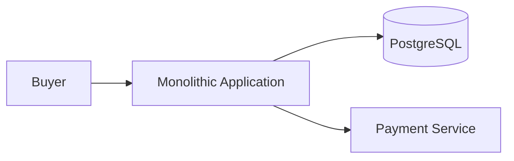
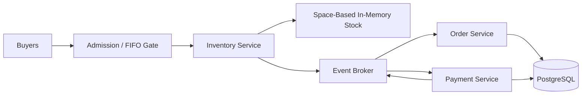
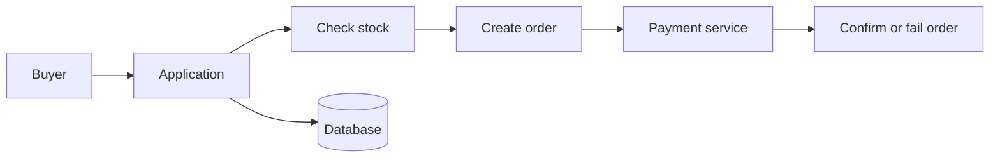

# Software Requirements Specification
## Flash Sale Purchase System

**Version:** 1.2  
**Prepared by:** Flash Sale Bottlenecks Project Team  
**Date:** 2026-11-09  
**Status:** Draft for Review

---

## Revision History

| Name | Date | Reason for Changes | Version |
|---|---|---|---|
| Project Team | 2026-10-24 | Initial problem statement based on project presentation | 0.1 |
| Project Team | 2026-10-26 | First complete SRS | 1.0 |
| Project Team | 2026-11-09 | Revised to match the IEEE course template and remove premature design decisions | 1.1 |
| Project Team | 2026-11-09 | Added selected hybrid architecture and fixed PostgreSQL as the persistent database | 1.2 |

---

# 1. Introduction

## 1.1 Purpose

This document describes the requirements for a flash-sale purchase system. The project focuses on a situation where a small amount of stock is offered to a very large number of buyers at the same time.

The reference scenario is **100 limited-edition items and about 10,000 buyers**, with most purchase requests arriving at the start of the sale.

The purpose of the project is not only to build the purchase flow, but also to identify where the baseline architecture becomes a bottleneck under heavy concurrent load and then evaluate possible architectural improvements.

## 1.2 Document Conventions

- Functional requirements use IDs such as `FR-1`, `FR-2`, etc.
- Performance requirements use IDs such as `PR-1`.
- The word **shall** means the requirement is mandatory.
- Priorities are written as **Must**, **Should**, or **Could**.
- Values such as latency limits are initial targets and may be revised after baseline testing.
- Major architecture decisions will be documented separately as ADRs.

## 1.3 Intended Audience and Reading Suggestions

This SRS is intended for the project team and the course supervisor.

Developers can use Sections 3 and 4 for interfaces and functional behaviour. Section 5 describes performance and quality requirements. Section 6 explains the database and testing requirements. The appendices contain the glossary, project model, bottlenecks, and items that are still undecided.

## 1.4 Product Scope

The system covers the purchase flow of a flash sale. It will:

- accept purchase requests during a sudden traffic spike;
- prevent the system from selling more items than are available;
- create and track reservations and orders;
- process payment without keeping database resources busy longer than necessary;
- handle repeated purchase attempts safely;
- use a defined rule for deciding which buyers get limited stock;
- collect enough measurements to identify the actual bottlenecks.

The project does **not** include a complete e-commerce platform. Product catalogue management, shipping, refunds, recommendations, and marketing pages are outside the project scope.

## 1.5 References

1. IEEE Software Requirements Specification Template provided for the course.
2. IEEE Std 830-1998, *IEEE Recommended Practice for Software Requirements Specifications*.
3. ADR repository: <https://github.com/architecture-decision-record/architecture-decision-record>.
4. Project presentation: *Flash Sale Bottlenecks — When 10,000 People Click Buy at Once*.

---

# 2. Overall Description

## 2.1 Product Perspective

The flash-sale system represents the purchase part of a larger e-commerce application. The project starts from a simple synchronous baseline so that its limitations can be observed under load before the resolution is implemented.

### Baseline architecture

In the baseline version, a buyer sends a purchase request to one application. The application checks inventory, creates an order, communicates with the payment service, and stores the result in PostgreSQL.

### Selected target architecture

The selected resolution is a **hybrid architecture** combining:

- **Microservices** for separating inventory, order, and payment responsibilities and allowing them to scale independently;
- **Event-Driven Architecture** so slow operations such as payment do not block the inventory path;
- **Space-Based Architecture** for the highly contended flash-sale inventory state, reducing direct pressure on the PostgreSQL stock record during the traffic burst;
- a **server-side admission/FIFO queue** to control the burst and provide a defined allocation order.

PostgreSQL remains the persistent system of record for orders, reservations, and durable sale data. The space-based layer is used for the hot inventory state during the sale, while events coordinate the later order and payment steps.

The main interest of the project is to compare the baseline with this selected architecture and measure whether the new design actually reduces the identified bottlenecks.

## 2.2 Product Functions

The main functions are:

- start and configure a flash sale;
- accept purchase requests;
- check and reserve available stock;
- create an order;
- process payment;
- confirm or cancel the order;
- return reserved stock when payment fails or times out;
- detect duplicate purchase attempts;
- inform the buyer of the current result or status;
- record system metrics for load testing.

## 2.3 User Classes and Characteristics

| User Class | Description |
|---|---|
| **Buyer** | Attempts to purchase an item during the flash sale and receives the result or current status. |
| **Administrator** | Configures the sale before it starts, including product, quantity, and start time. |
| **Project operator/developer** | Runs tests and checks system metrics during experiments. |

## 2.4 Operating Environment

The planned environment is:

- Java 21;
- Spring Boot;
- **PostgreSQL** as the persistent relational database;
- separate Inventory, Order, and Payment services in the improved architecture;
- a distributed in-memory component for the space-based inventory layer;
- an event broker for asynchronous communication between services;
- a REST-based or simulated payment service;
- a load-testing tool such as k6 or Gatling;
- local or container-based deployment for testing.

The exact product used for the in-memory space and the event broker will be recorded in ADRs once the implementation technology is chosen.

## 2.5 Design and Implementation Constraints

| ID | Constraint |
|---|---|
| C-1 | The backend will be implemented in Java with Spring Boot. |
| C-2 | PostgreSQL will be used as the persistent system of record for orders, reservations, and durable sale data. |
| C-3 | Payment processing is treated as an external dependency and may be slow. |
| C-4 | Client-side timestamps will not be used as the only basis for deciding who receives stock. |
| C-5 | The baseline architecture must be tested before major architectural improvements are added. |
| C-6 | Major architecture decisions must be recorded as ADRs. |
| C-7 | The improved implementation will combine Microservices, Event-Driven, and Space-Based architectural patterns. |
| C-8 | The improved architecture will use a server-side admission/FIFO mechanism to control flash-sale traffic and allocation order. |

## 2.6 User Documentation

The project will include:

- a `README.md` with setup and run instructions;
- this SRS in Markdown;
- ADR files for important architecture decisions;
- basic instructions for running the load tests.

A separate end-user manual is not required because the buyer interaction is small.

## 2.7 Assumptions and Dependencies

| ID | Assumption / Dependency |
|---|---|
| AS-1 | Each buyer can be identified by a stable user ID during testing. |
| AS-2 | The payment service can be simulated so that slow and failed payments can be tested. |
| AS-3 | The main experiment uses one flash-sale product with limited stock. |
| AS-4 | Exact performance targets may change after the baseline system is measured. |

---

# 3. External Interface Requirements

## 3.1 User Interfaces

The user interface only needs to support the basic flash-sale flow.

| ID | Requirement |
|---|---|
| UI-1 | The buyer shall be able to submit a purchase request. |
| UI-2 | The system shall show whether the request is waiting, reserved, confirmed, failed, or sold out. |
| UI-3 | The interface shall avoid encouraging repeated clicks while a request is still being processed. |

## 3.2 Hardware Interfaces

No special hardware is required. The system will run on standard development machines or servers.

## 3.3 Software Interfaces

| ID | Interface | Description |
|---|---|---|
| SI-1 | PostgreSQL | Persistent system of record for sale, reservation, order, and payment data. |
| SI-2 | Space-based in-memory component | Holds the highly contended inventory state during the flash-sale burst. |
| SI-3 | Event broker | Carries events between Inventory, Order, and Payment services. |
| SI-4 | Payment service | Simulates or performs payment processing. |
| SI-5 | Load-testing tool | Generates concurrent purchase requests. |

## 3.4 Communications Interfaces

| ID | Requirement |
|---|---|
| CI-1 | Client and server communication shall use HTTP/HTTPS. |
| CI-2 | Purchase requests shall be sent through a REST endpoint. |
| CI-3 | The buyer shall be able to retrieve the current purchase status. |

---

# 4. System Features

## 4.1 Purchase Request Handling

### 4.1.1 Description and Priority

**Priority: High / Must**

This feature accepts purchase requests and controls how they enter the purchase flow during heavy traffic.

### 4.1.2 Stimulus/Response Sequences

1. The buyer sends a purchase request.
2. The server validates it.
3. The request either continues to stock processing, waits, or receives a sold-out response.
4. The system records enough information to keep the processing order clear.

### 4.1.3 Functional Requirements

| ID | Requirement | Priority |
|---|---|---|
| FR-1 | The system shall accept valid purchase requests for an active flash sale. | Must |
| FR-2 | The system shall be able to limit how many requests reach the stock-processing step at the same time. | Must |
| FR-3 | The system shall use a server-side rule to determine processing order when demand is higher than stock. | Must |
| FR-4 | When stock is exhausted, later requests shall receive a sold-out response without unnecessary database work. | Must |

## 4.2 Stock Reservation

### 4.2.1 Description and Priority

**Priority: High / Must**

This feature prevents overselling when many users try to purchase the last available units at the same time.

### 4.2.2 Stimulus/Response Sequences

1. A valid request reaches the stock step.
2. The system checks whether stock is available.
3. If stock is available, one unit is reserved safely.
4. If not, the request is rejected as sold out.
5. If the reservation later fails or expires, the unit is returned to stock.

### 4.2.3 Functional Requirements

| ID | Requirement | Priority |
|---|---|---|
| FR-5 | Stock checking and stock claiming shall be performed so that two buyers cannot successfully claim the same final unit. | Must |
| FR-6 | Available stock shall never become negative. | Must |
| FR-7 | A buyer shall not reserve more than the allowed quantity for the sale. | Must |
| FR-8 | A reservation shall expire if payment is not completed within the configured time. | Must |

## 4.3 Order and Payment Processing

### 4.3.1 Description and Priority

**Priority: High / Must**

Payment can be slower than the rest of the purchase flow. The system should avoid keeping database resources occupied while waiting for the payment service.

### 4.3.2 Stimulus/Response Sequences

1. Stock is reserved.
2. A pending order is created.
3. Payment is requested.
4. If payment succeeds, the order is confirmed.
5. If payment fails or times out, the order fails and the reserved stock is released.

### 4.3.3 Functional Requirements

| ID | Requirement | Priority |
|---|---|---|
| FR-9 | The system shall create a pending order after successful stock reservation. | Must |
| FR-10 | The system shall not keep a database transaction open while waiting for an external payment response. | Must |
| FR-11 | Successful payment shall change the order status to confirmed. | Must |
| FR-12 | Failed or timed-out payment shall release the reserved stock. | Must |

## 4.4 Duplicate Request Handling

### 4.4.1 Description and Priority

**Priority: High / Must**

Users may click again or a client may retry when the system is slow. The same logical purchase should not create multiple orders or charges.

### 4.4.2 Stimulus/Response Sequences

1. A purchase request is received.
2. The system checks whether the same logical request has already been handled.
3. A new request is processed normally.
4. A duplicate request returns the result of the original request instead of creating another purchase.

### 4.4.3 Functional Requirements

| ID | Requirement | Priority |
|---|---|---|
| FR-13 | The system shall identify repeated purchase attempts using a unique request identifier or equivalent mechanism. | Must |
| FR-14 | A repeated request shall not create a second reservation, order, or successful charge. | Must |

## 4.5 Monitoring and Experiment Support

### 4.5.1 Description and Priority

**Priority: High / Must**

The project must be able to show where the architecture becomes a bottleneck instead of only assuming what the problem is.

### 4.5.2 Stimulus/Response Sequences

1. A test run starts.
2. The load-testing tool generates concurrent purchase requests.
3. The application records important metrics.
4. After the run, the team compares the results and identifies the main bottleneck.

### 4.5.3 Functional Requirements

| ID | Requirement | Priority |
|---|---|---|
| FR-15 | The system shall expose or record request latency and error rate. | Must |
| FR-16 | The system shall record database connection usage and, where possible, lock waiting time. | Must |
| FR-17 | The system shall record payment response time. | Must |
| FR-18 | The system shall allow the team to check whether overselling or duplicate orders occurred. | Must |

---

# 5. Other Nonfunctional Requirements

## 5.1 Performance Requirements

The first tests will use the reference scenario of **100 units and about 10,000 concurrent buyers**.

| ID | Requirement | Target |
|---|---|---|
| PR-1 | Oversold units | 0 |
| PR-2 | Duplicate successful charges for the same logical purchase | 0 |
| PR-3 | The system shall remain measurable under burst load instead of failing silently. | Required |
| PR-4 | Response time, throughput, error rate, DB connection usage, and payment delay shall be measured during each test. | Required |

Exact latency and throughput targets are intentionally left open until the baseline version is tested. The purpose of the first experiment is to find the real system limit.

## 5.2 Safety Requirements

The system is not safety-critical in the physical sense, but incorrect behaviour can cause financial or transactional problems.

| ID | Requirement |
|---|---|
| SAF-1 | The system shall not confirm more orders than the available stock. |
| SAF-2 | The same purchase attempt shall not cause multiple successful charges. |
| SAF-3 | Failed or expired reservations shall return stock correctly. |

## 5.3 Security Requirements

| ID | Requirement |
|---|---|
| SE-1 | Purchase requests shall be associated with an identified user in the test system. |
| SE-2 | Administrative sale configuration shall not be available to normal buyers. |
| SE-3 | Card details shall not be stored by the flash-sale application. |
| SE-4 | Production-style communication should use HTTPS. |

## 5.4 Software Quality Attributes

| Attribute | Requirement |
|---|---|
| **Correctness** | Stock and order states shall remain consistent under concurrent requests. |
| **Reliability** | A successful purchase result shall not be lost because another noncritical operation fails. |
| **Scalability** | Inventory, order, and payment processing shall be separable so that overloaded parts can be scaled independently. |
| **Maintainability** | Inventory, order, and payment responsibilities shall remain clearly separated across the selected services. |
| **Fairness** | The system shall use a defined server-side allocation rule when demand exceeds stock. |
| **Testability** | The important bottlenecks and requirements shall be testable with automated load and functional tests. |

## 5.5 Business Rules

| ID | Business Rule |
|---|---|
| BR-1 | A flash sale has a start time and a fixed initial quantity. |
| BR-2 | A buyer may only purchase up to the configured limit. |
| BR-3 | Once all stock is reserved or sold, additional buyers cannot receive confirmed orders unless stock is released again. |
| BR-4 | A failed or expired reservation returns its unit to available stock. |
| BR-5 | The same logical purchase attempt must not produce more than one successful charge. |

---

# 6. Other Requirements

## 6.1 Logical Database Requirements

The first version requires the following main data objects:

- **Sale** — identifies the flash sale and its initial stock.
- **Inventory** — stores the current available quantity.
- **Reservation** — stores temporary stock claims.
- **Order** — stores the purchase state.
- **Payment Attempt** — stores payment results used for testing and reconciliation.
- **Request Identifier** — helps detect repeated purchase attempts.

The exact table structure may change during implementation.

Basic database rules are:

| ID | Requirement |
|---|---|
| DB-1 | Available stock shall not be stored as a negative value. |
| DB-2 | Order and reservation data shall be stored persistently. |
| DB-3 | Duplicate request identifiers shall be detectable. |
| DB-4 | The database shall support the transaction behaviour required for safe stock reservation. |

## 6.2 Verification and Load Testing

The project will use the following approach:

**build the baseline -> load-test it -> identify the bottleneck -> change one architectural decision -> test again**

Planned tests include:

| Test | Setup | Purpose |
|---|---|---|
| T-1 Burst test | 10,000 buyers, stock 100 | Observe the first bottleneck under sudden load |
| T-2 Overselling test | Many buyers, stock 1 | Check whether concurrent requests can oversell |
| T-3 Slow payment test | Artificial payment delay | Check whether payment blocks DB or application resources |
| T-4 Retry test | Repeat the same request several times | Check duplicate-order and duplicate-charge protection |
| T-5 Payment failure test | Some payments fail | Check whether reserved stock is returned correctly |
| T-6 Fairness test | Many buyers arrive close together | Check whether the chosen server-side rule is followed |

The main measurements will be response time, throughput, error rate, active database connections, lock wait time where available, payment delay, oversold units, and duplicate orders.

## 6.3 Architecture Decision Records

Important architecture decisions will be documented separately as ADRs. The selected architectural direction is already fixed, while technology-level choices will be recorded in individual ADRs. Planned ADR topics are:

- use **PostgreSQL** as the persistent system of record;
- use a **Space-Based Architecture** for the hot flash-sale inventory state;
- use **Event-Driven Architecture** for communication after stock reservation;
- split the improved system into **Inventory, Order, and Payment microservices**;
- use a **server-side admission/FIFO queue** for overload control and fairness;
- use idempotency to handle retries and duplicate purchase/payment requests;
- choose the concrete in-memory data-grid technology and event-broker technology.

## 6.4 Selected Architecture and Bottleneck Mapping

The project uses a hybrid architecture because no single pattern resolves all of the identified bottlenecks.

| Identified problem | Selected architectural response |
|---|---|
| Sudden burst of 10,000 purchase requests | Server-side admission/FIFO queue limits how many requests enter the critical path at once. |
| Shared inventory record / database contention | Space-Based Architecture moves the hot inventory state to a distributed in-memory layer during the sale. |
| Overselling | Inventory Service performs the stock claim as one safe atomic operation. |
| Slow payment blocks resources | Event-Driven Architecture separates payment processing from the inventory transaction. |
| Different parts need different scaling | Microservices allow Inventory, Order, and Payment services to scale independently. |
| Retry storm / duplicate purchase | Idempotent request handling prevents the same logical request from creating repeated orders or charges. |
| Fairness | Server-side FIFO ordering provides a defined allocation rule for accepted requests. |

The selected design intentionally introduces distributed-system trade-offs such as event ordering, eventual consistency, duplicate message handling, and additional operational complexity. These trade-offs will be evaluated during implementation and testing rather than treated as automatically better than the baseline.

---

# Appendix A: Glossary

| Term | Meaning |
|---|---|
| **Flash sale** | A sale where limited stock is released at a fixed time and many buyers may arrive together. |
| **Bottleneck** | A part of the system that limits the overall performance. |
| **Race condition** | A problem where the result depends on the timing of concurrent operations. |
| **Atomic operation** | An operation that is completed as one indivisible step. |
| **Reservation** | A temporary hold on one unit of stock. |
| **Idempotency** | Repeating the same request has the same final effect as processing it once. |
| **Connection pool** | A limited set of database connections shared by the application. |
| **FIFO** | First In, First Out. |
| **ADR** | Architecture Decision Record. |

---

# Appendix B: Analysis Models

## B.1 Baseline Purchase Flow

## B.2 Selected Hybrid Architecture

The architecture combines Microservices, Event-Driven Architecture, Space-Based Architecture, and admission control. PostgreSQL remains the durable system of record.

## B.3 Main Bottlenecks to Investigate

1. **Shared inventory contention** — many requests try to update the same stock data.
2. **Overselling** — concurrent requests may both observe the same remaining unit.
3. **Database connection exhaustion** — slow processing may keep connections busy while new requests arrive.
4. **Slow payment dependency** — the external payment service may delay the whole purchase path.
5. **Retry amplification** — slow responses may cause repeated requests and add more load.
6. **Fairness** — the system needs a defined rule for deciding which buyers get the limited stock.

These are the expected bottlenecks based on the project analysis. Load testing will show which one becomes the main limitation first.

---

# Appendix C: To Be Determined List

The following implementation details are intentionally not fixed yet:

1. Exact request-admission/FIFO queue implementation.
2. Exact distributed in-memory technology used for the Space-Based Architecture.
3. Exact event-broker technology used for Event-Driven Architecture.
4. Exact reservation timeout value.
5. Exact latency and throughput targets after baseline measurement.
6. Exact number of service instances used during load testing.
7. Final deployment topology for the improved architecture.

The following decisions are now fixed for the project: **PostgreSQL** as the persistent database and a hybrid **Microservices + Event-Driven + Space-Based** target architecture with server-side admission control.
